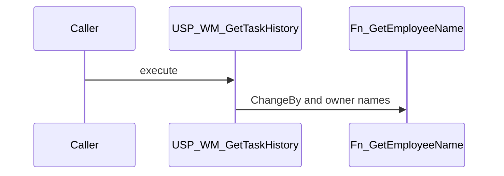
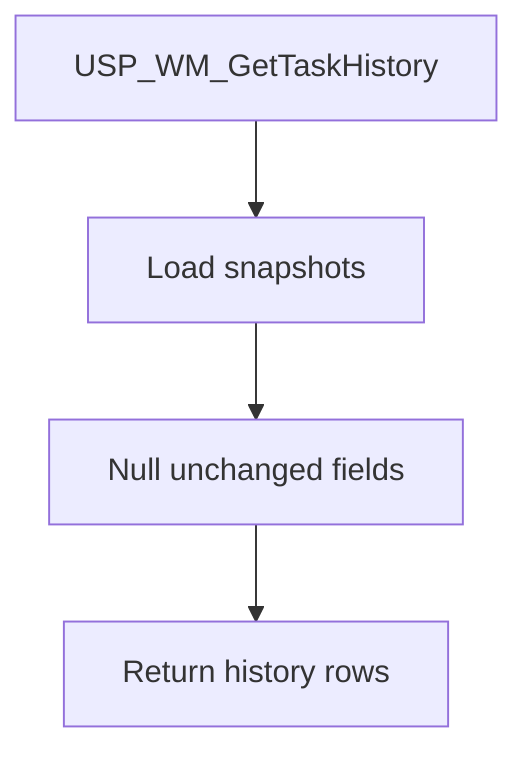

# USP_WM_GetTaskHistory

## What it does

Returns successive history snapshots for the given task guids, nulling unchanged fields after the first snapshot so the client can render a Task History list. Used by Nest GET /tasks/task-history from the My Work drawer.

## Parameters

| Name | Direction | What it is for |
|---|---|---|
| @TaskGuids | in | Comma-separated task guids |

## Call sequence

## Callers

No other procedure or function executes this object. Application caller: Nest tasks history GET.

## Nested

| Object | Kind | When | Page |
|---|---|---|---|
| Fn_GetEmployeeName | function | name columns | [Fn_GetEmployeeName](/docs/database/hrms/Fn_GetEmployeeName) |

## Steps

1. Parse guids; load TWM_TaskHistory ordered by change time.
2. LAG prior snapshot values; for rn greater than 1 return only changed columns (else null).
3. Attach assignment change details and display names.

## Tables

| Table | Read or write |
|---|---|
| TWM_TaskHistory | read |
| TWM_TaskAssignments | read |

## Flow

