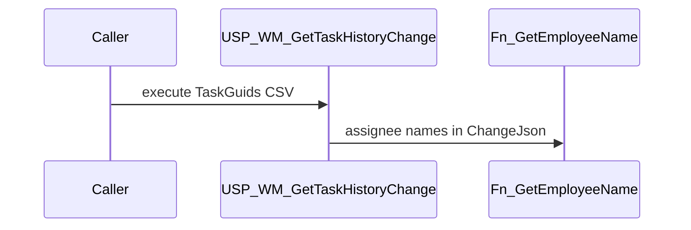
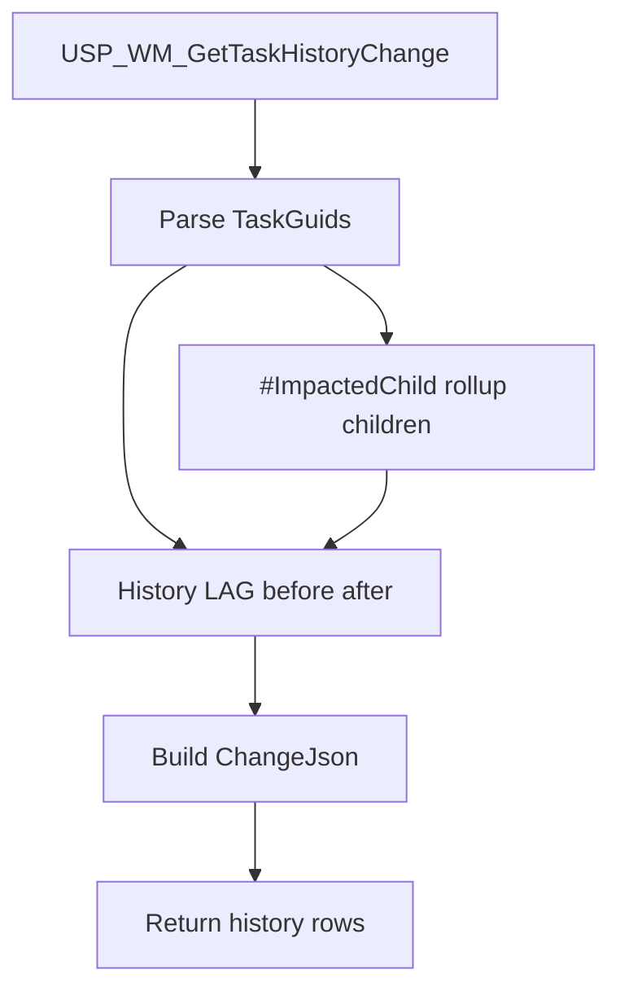

# USP_WM_GetTaskHistoryChange

## What it does

Given a comma-separated list of task guids, expands task history into before/after field diffs (`ChangeJson`), including assignee JSON with display names, timeline-request JSON, and project name. Also pulls history for **child** tasks that caused parent rollup (`ImpactChangedOn`) so parent rows can show the five rollup-propagated fields. Used nested from `USP_WM_GetTeamLatestTaskChanges` (My Work team recent-changes) and other history/timeline callers.

## Parameters

| Name | Direction | What it is for |
|---|---|---|
| `@TaskGuids` | in | Comma-separated `UNIQUEIDENTIFIER` list (`STRING_SPLIT`) |

## Call sequence

## Callers

| Object | Kind | Page |
|---|---|---|
| `USP_WM_GetTeamLatestTaskChanges` | procedure | [USP_WM_GetTeamLatestTaskChanges](/docs/database/hrm-timeport/USP_WM_GetTeamLatestTaskChanges) |
| Nest task-history routes (SystemModel) | app | [My Work](/docs/guides/task-management/my-work) (team changes path) |

## Nested

| Object | Kind | When | Page |
|---|---|---|---|
| `Fn_GetEmployeeName` | function | assignee JSON name fields | [Fn_GetEmployeeName](/docs/database/hrms/Fn_GetEmployeeName) |

## Steps

From the live `HRM_CL_TIMEPORT` definition (large body; summary):

1. `SET NOCOUNT ON`; `READ UNCOMMITTED`.
2. Parse `@TaskGuids` into distinct guids; load `#ImpactedChild` history for children referenced by `ImpactChangedOn` on those parents (rollup fields only).
3. Build ordered history CTE with `LAG` previous values for planned dates/duration, completion, status, and related columns.
4. Compose `ChangeJson` / compare JSON for scalar fields and for assignee sets from `TWM_TaskAssignmentsHistory` (names via `Fn_GetEmployeeName`).
5. Final SELECT joins project name from `TProject` and returns `TaskID`, `TaskGuid`, `TaskHistoryID`, `ProjectID`, `TaskNumber`, `TaskTitle`, `ProjectName`, `TimelineRequestJson`, `ChangeJson`.

## Tables

| Table | Read or write |
|---|---|
| `TWM_TaskHistory` | read |
| `TWM_TaskAssignmentsHistory` | read |
| `TWM_ReferenceMaster` | read |
| `TProject` | read |

## Unresolved calls

None in the portion verified for name resolution; body is large and field-diff logic is entirely inline SQL.

## Flow

