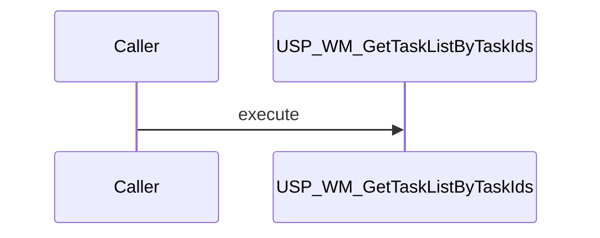
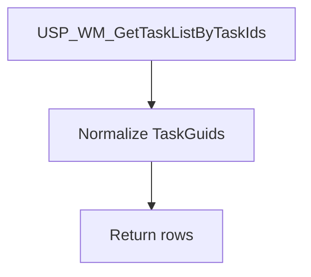

# USP_WM_GetTaskListByTaskIds

## What it does

Returns a permission-enriched task projection for a CSV of TaskGuids (similar shape to the project list SPs), used to refresh the client after upsert.

## Parameters

| Name | Direction | What it is for |
|---|---|---|
| `@TaskIds` | in | Comma-separated TaskGuids (`NVARCHAR(MAX)`) |
| `@EmplolyeeId` | in | Calling employee id — note spelling in live signature (`INT`) |

## Call sequence

## Callers

[`USP_WM_UpsertTaskWithAssignments_V3`](/docs/database/hrm-timeport/USP_WM_UpsertTaskWithAssignments_V3)

## Nested

This object does not execute another procedure. Inline `Fn_GetEmployeeName` (HRMS) may appear in SELECT lists.

## Steps

In live DEV `HRM_CL_TIMEPORT.dbo.USP_WM_GetTaskListByTaskIds`:

1. Sets `READ UNCOMMITTED` and normalizes CSV TaskGuids.
2. Builds permission CTE from access-group tables.
3. Returns hierarchy/task/assignment/timeline projection for those guids.

## Tables

| Table | Read or write |
|---|---|
| `TWM_TAccessGroupPermissions` | read |
| `TWM_Task` | read |
| `TWM_TaskActivityDetail` | read |
| `TWM_TaskSupportDocuments` | read |
| `TWM_TAccessGroupMembers` | read |
| `TWM_HandoffBatchTask` | read |
| `TWM_HandoffBatch` | read |
| `TWM_TaskAssignments` | read |
| `TWM_TaskTimelineUpdateRequests` | read |
| `TOrgHierarchyDetails` | read |
| `TEmployeeInfo` | read |
| `TSupportDocumentsMetadata` | read |

## Unresolved calls

None beyond inline `Fn_GetEmployeeName`.

## Flow

