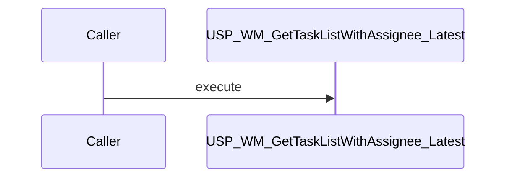
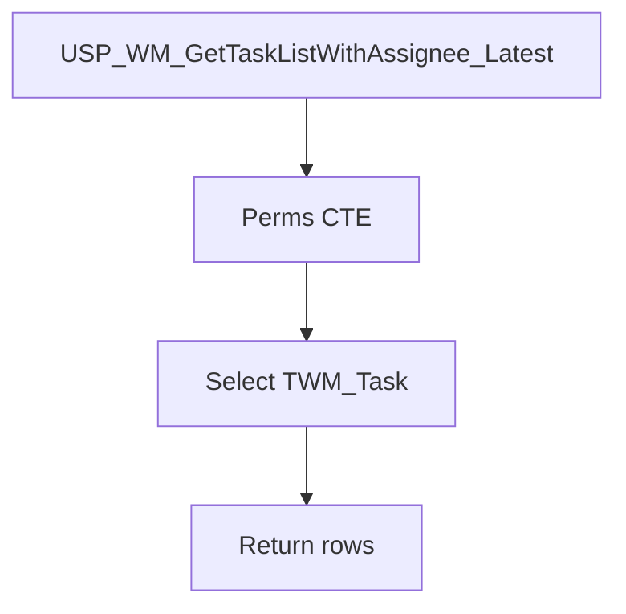

# USP_WM_GetTaskListWithAssignee_Latest

## What it does

Returns active tasks for one employer/project with assignee JSON, pending timeline-request JSON, attachment/work-duration flags, and per-row Create/Update/View permission bits derived from virtual Task Creater / Task Assignee groups and whether the caller is creator and/or assignee.

## Parameters

| Name | Direction | What it is for |
|---|---|---|
| `@EmployerId` | in | Employer id (`INT`) |
| `@ProjectId` | in | Project id (`INT`) |
| `@EmplolyeeId` | in | Calling employee id — note spelling in live signature (`INT`) |

## Call sequence

## Callers

Work Management Tasks board (catalog). Exact API caller not in SourceCode checkout.

## Nested

This object does not execute another procedure. Inline `Fn_GetEmployeeName` (HRMS) appears in SELECT lists for assignee/timeline labels.

## Steps

In live DEV `HRM_CL_TIMEPORT.dbo.USP_WM_GetTaskListWithAssignee_Latest`:

1. Builds a `Perms` CTE from virtual `TWM_TAccessGroupPermissions` rows for Task Creater / Task Assignee.
2. Selects active `TWM_Task` rows for the employer/project.
3. Projects assignee JSON from `TWM_TaskAssignments`, timeline JSON from pending `TWM_TaskTimelineUpdateRequests`, attachment and activity-duration flags, and role-based permission bits.
4. Returns the result set ordered by `TaskGuid`.

## Tables

| Table | Read or write |
|---|---|
| `TWM_TAccessGroupPermissions` | read |
| `TWM_Task` / `TWM_TASK` | read |
| `TWM_TaskAssignments` | read |
| `TWM_TaskTimelineUpdateRequests` | read |
| `TWM_TaskSupportDocuments` | read |
| `TWM_TaskActivityDetail` | read |

## Unresolved calls

None beyond inline `Fn_GetEmployeeName`.

## Flow

