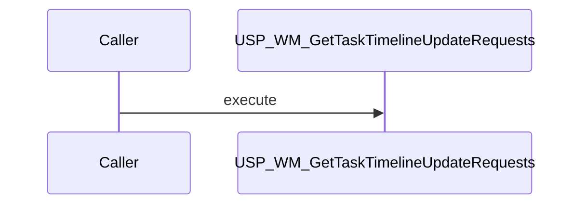
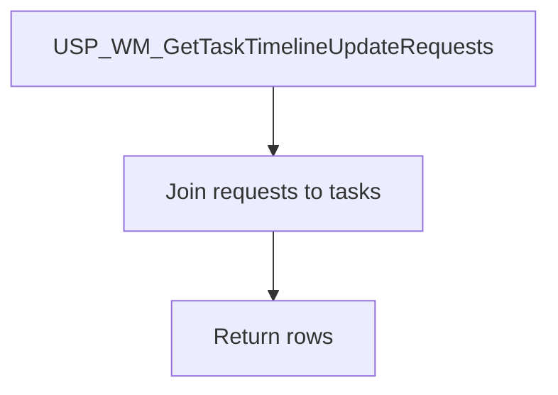

# USP_WM_GetTaskTimelineUpdateRequests

## What it does

Lists timeline update request rows joined to active tasks, optionally filtered by ProjectId, with requestor/reviewer display names via `Fn_GetEmployeeName`.

## Parameters

| Name | Direction | What it is for |
|---|---|---|
| `@EmployerId` | in | Employer id (`INT`) — present in signature; employer filter is commented out in live body |
| `@ProjectId` | in | Optional project filter (`INT`, default NULL) |

## Call sequence

## Callers

Catalog `GET /tasks/timeline-update-requests`.

## Nested

This object does not execute another procedure. Inline `Fn_GetEmployeeName` (HRMS) labels requestor/reviewer.

## Steps

In live DEV `HRM_CL_TIMEPORT.dbo.USP_WM_GetTaskTimelineUpdateRequests`:

1. Selects request rows from `TWM_TaskTimelineUpdateRequests` joined to active `TWM_Task`.
2. Optionally filters by `@ProjectId`.
3. Returns request fields plus display names.

## Tables

| Table | Read or write |
|---|---|
| `TWM_TaskTimelineUpdateRequests` | read |
| `TWM_Task` | read |

## Unresolved calls

None beyond inline `Fn_GetEmployeeName`.

## Flow

