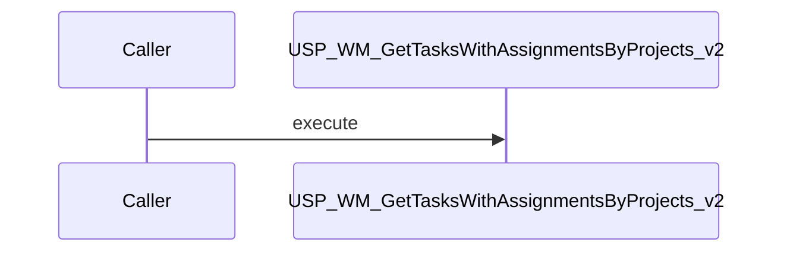
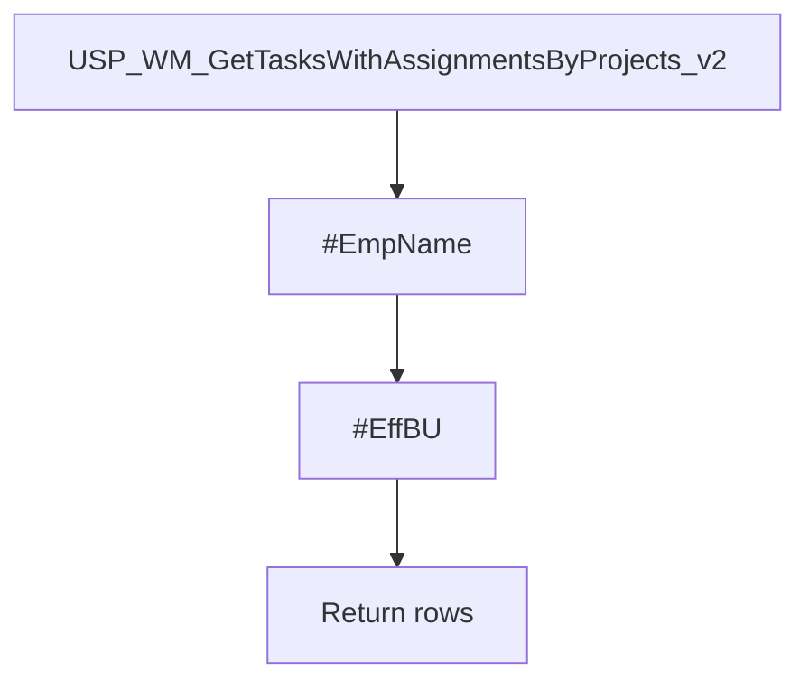

# USP_WM_GetTasksWithAssignmentsByProjects_v2

## What it does

Projects a multi-project task set with assignments, timeline requests, effective accountable BU (recursive parent chain with project fallback), and access bits. Resolves employee display names once into a temp table via `Fn_GetEmployeeName`.

## Parameters

| Name | Direction | What it is for |
|---|---|---|
| `@ProjectIds` | in | Comma-separated project ids (`VARCHAR(MAX)`) |
| `@EmplolyeeId` | in | Calling employee id — note spelling in live signature (`INT`) |

## Call sequence

## Callers

Work Management Tasks / multi-project views (catalog). Exact API caller not in SourceCode checkout.

## Nested

This object does not execute another procedure. Inline `Fn_GetEmployeeName` (HRMS) fills `#EmpName`.

## Steps

In live DEV `HRM_CL_TIMEPORT.dbo.USP_WM_GetTasksWithAssignmentsByProjects_v2`:

1. Sets `READ UNCOMMITTED`.
2. Builds `#EmpName` for distinct employee ids on the project set.
3. Builds `#EffBU` via recursive CTE over parent tasks with `TProject` fallback.
4. Returns the multi-project task/assignment projection with permission bits.

## Tables

| Table | Read or write |
|---|---|
| `TWM_TaskAssignments` | read |
| `TWM_Task` | read |
| `TWM_TaskTimelineUpdateRequests` | read |
| `TProject` | read |
| `TWM_TAccessGroupPermissions` | read |
| `TWM_TaskActivityDetail` | read |
| `TWM_TAccessGroupMembers` | read |
| `TWM_HandoffBatchTask` | read |
| `TWM_HandoffBatch` | read |
| `TEmployee` | read |

## Unresolved calls

None beyond inline `Fn_GetEmployeeName`.

## Flow

