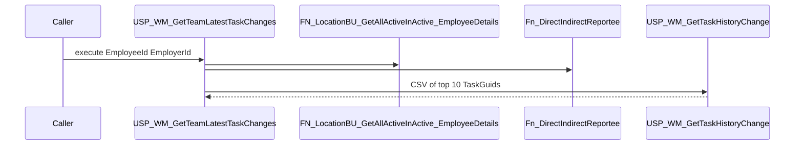
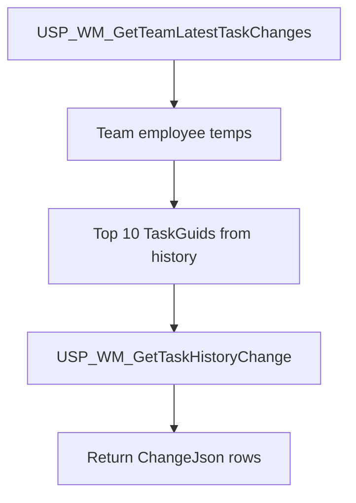

# USP_WM_GetTeamLatestTaskChanges

## What it does

Builds the same team employee set as the team week board, picks the **top 10** `TWM_TaskHistory` task guids most recently touched for that team (by assignee membership, or by history owner/creator when unassigned), expands those guids through `USP_WM_GetTaskHistoryChange`, and returns up to 10 history/change rows (`ChangeJson`, timeline request JSON, project name). Used by Nest `GET /my-work/team/latest-task-changes`.

## Parameters

| Name | Direction | What it is for |
|---|---|---|
| `@EmployeeId` | in | Manager whose team scopes visibility |
| `@EmployerId` | in | Employer filter on team members |

## Call sequence

## Callers

| Object | Kind | Page |
|---|---|---|
| Nest `GET /my-work/team/latest-task-changes` | app | [My Work](/docs/guides/task-management/my-work) |

## Nested

| Object | Kind | When | Page |
|---|---|---|---|
| `FN_LocationBU_GetAllActiveInActive_EmployeeDetails` | function | always | [FN_LocationBU_GetAllActiveInActive_EmployeeDetails](/docs/database/hrms/FN_LocationBU_GetAllActiveInActive_EmployeeDetails) |
| `Fn_DirectIndirectReportee` | function | always | [Fn_DirectIndirectReportee](/docs/database/hrms/Fn_DirectIndirectReportee) |
| `USP_WM_GetTaskHistoryChange` | procedure | always — `INSERT #Result EXEC …` | [USP_WM_GetTaskHistoryChange](/docs/database/hrm-timeport/USP_WM_GetTaskHistoryChange) |

## Steps

From the live `HRM_CL_TIMEPORT` definition:

1. Build `#AllEmployees` / `#TeamEmployees` (same pattern as team week SP); self-include.
2. `STRING_AGG` the top 10 `TaskGuid` values from `TWM_TaskHistory` ordered by `COALESCE(UpdatedAt, CreatedAt)` where the task has an active team assignee **or** history `OwnerID` / `CreatedBy` is on the team.
3. `INSERT INTO #Result EXEC USP_WM_GetTaskHistoryChange @TaskGuidList`.
4. `SELECT TOP 10 * FROM #Result ORDER BY TaskHistoryID DESC`.

## Tables

| Table | Read or write |
|---|---|
| `TEmployee` | read |
| `TWM_TaskHistory` | read |
| `TWM_TaskAssignments` | read |

(Nested history procedure also reads assignment-history / project tables.)

## Unresolved calls

None.

## Flow

