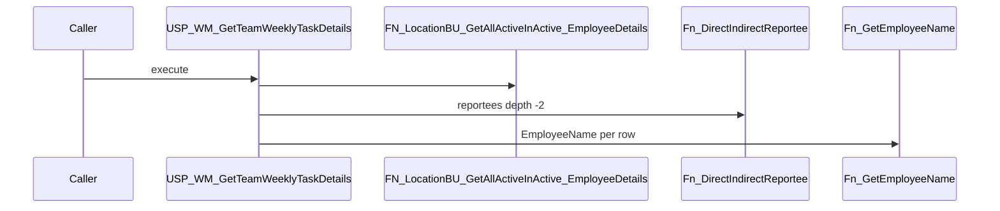
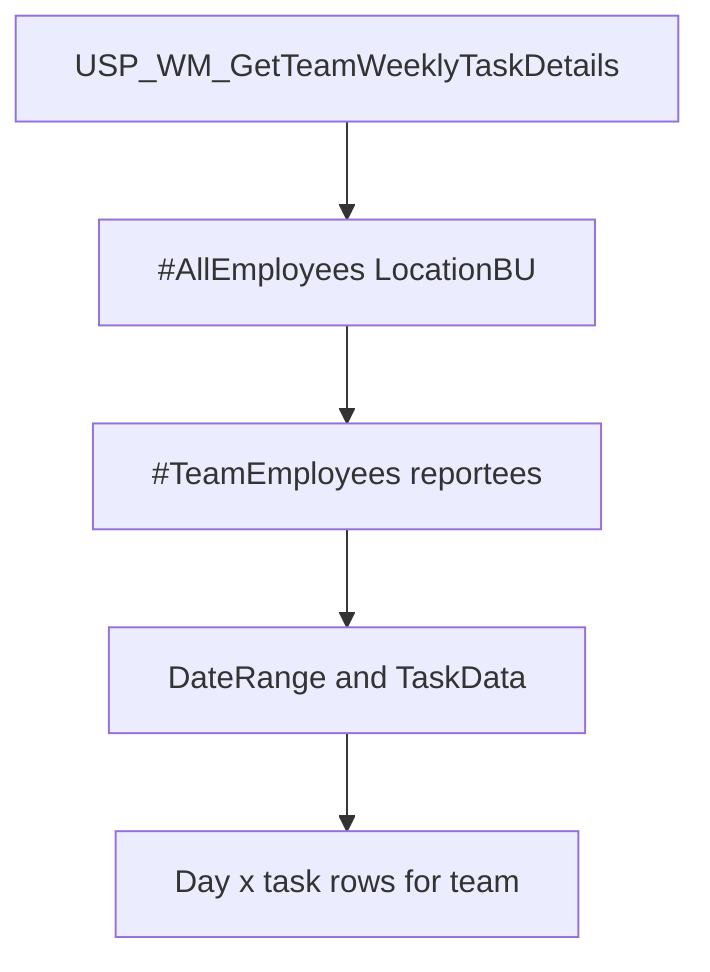

# USP_WM_GetTeamWeeklyTaskDetails

## What it does

Same day × task shape as `USP_WM_GetEmployeeWeeklyTasks`, but for the caller’s **team**: builds `#AllEmployees` from location/BU visibility, intersects with `Fn_DirectIndirectReportee(@EmployeeId, -2)`, always includes self, then plots active assignments for those employees inside the date/`@ProjectId` window. Used by Nest `GET /my-work/team` for My Team Work.

## Parameters

| Name | Direction | What it is for |
|---|---|---|
| `@EmployeeId` | in | Manager (or self) whose reportees define the team |
| `@EmployerId` | in | Employer filter on employees and tasks |
| `@ProjectId` | in | Comma-separated project ids; empty CSV → no task rows |
| `@StartDate` | in | Inclusive board start |
| `@EndDate` | in | Inclusive board end |

## Call sequence

## Callers

| Object | Kind | Page |
|---|---|---|
| Nest `GET /my-work/team` | app | [My Work](/docs/guides/task-management/my-work) |

## Nested

| Object | Kind | When | Page |
|---|---|---|---|
| `FN_LocationBU_GetAllActiveInActive_EmployeeDetails` | function | always — `#AllEmployees` | [FN_LocationBU_GetAllActiveInActive_EmployeeDetails](/docs/database/hrms/FN_LocationBU_GetAllActiveInActive_EmployeeDetails) |
| `Fn_DirectIndirectReportee` | function | always — team set | [Fn_DirectIndirectReportee](/docs/database/hrms/Fn_DirectIndirectReportee) |
| `Fn_GetEmployeeName` | function | final SELECT | [Fn_GetEmployeeName](/docs/database/hrms/Fn_GetEmployeeName) |

## Steps

From the live `HRM_CL_TIMEPORT` definition:

1. Populate `#AllEmployees` from `FN_LocationBU_GetAllActiveInActive_EmployeeDetails(@EmployeeId, @EmployerId)`.
2. Populate `#TeamEmployees` from `Fn_DirectIndirectReportee(@EmployeeId, -2)` intersected with active `TEmployee` on `@EmployerId` and `#AllEmployees`; insert `@EmployeeId` if missing.
3. Mirror the employee week CTEs (`DateRange`, `TaskData` scoped to `#TeamEmployees`, activity aggregates, `FinalTask` effective dates).
4. Return day × task rows ordered by `EmployeeId`, `TaskGuid`, `WorkDate`, with reference labels and `Fn_GetEmployeeName`.

## Tables

| Table | Read or write |
|---|---|
| `TEmployee` | read |
| `TWM_Task` | read |
| `TWM_TaskAssignments` | read |
| `TWM_TaskActivityDetail` | read |
| `TWM_ReferenceMaster` | read |
| `TProject` | read |

## Unresolved calls

None.

## Flow

