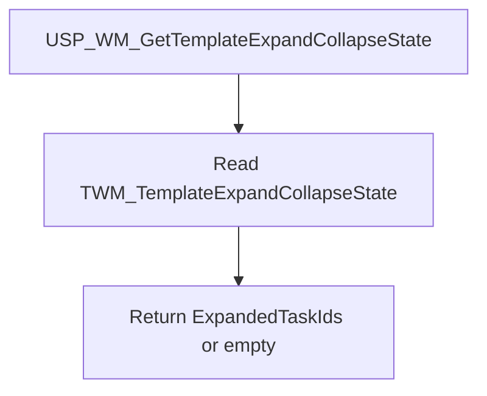

# USP_WM_GetTemplateExpandCollapseState

## What it does

Returns the saved expand/collapse id list for one viewer on one template’s Edit tree. Mirrors the Tasks expand-collapse helper but keys by `TemplateId` instead of project/BU. Empty result means nothing saved yet (client falls back to default expansion).

## Parameters

| Name | Direction | What it is for |
|---|---|---|
| `@EmployerId` | in | Tenant |
| `@TemplateId` | in | Template being edited |
| `@EmployeeId` | in | Viewer |

## Call sequence

1. `SELECT TOP 1 ExpandedTaskIds` from `TWM_TemplateExpandCollapseState` for the triple

## Callers

No other procedure calls this object. App callers: `TemplatesRepository.getExpandCollapseState` → `TemplatesController.getExpandCollapseState` from [Project Templates](/docs/guides/task-management/project-templates).

## Nested

None.

## Steps

1. Definition read from live `HRM_CL_TIMEPORT.dbo.USP_WM_GetTemplateExpandCollapseState`.
2. `NOLOCK` select filtered by employer, template, employee.

## Tables

| Table | Read or write |
|---|---|
| `TWM_TemplateExpandCollapseState` | read |

## Unresolved calls

None.

## Flow

