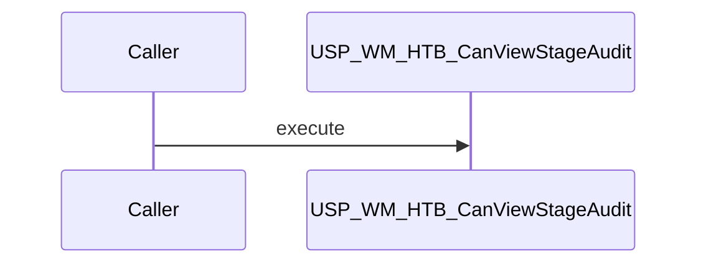
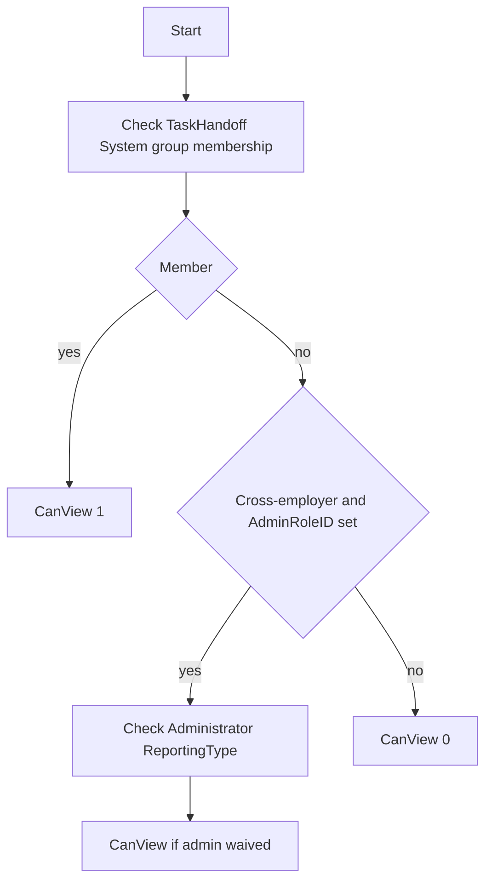

# USP_WM_HTB_CanViewStageAudit

## What it does

Stage Audit visibility gate. Returns one row: `CanView`, `IsHandoffGroupMember`, `IsAdminWaived`. Viewing requires active membership in the employer’s System access group with `FeatureCategory = 'TaskHandoff'`. Individual stage bits are **not** consulted for view. When `@IsHomeEmployerCheck = 0` (selected non-home employer) and `@AdminRoleID` is supplied, a Core Administrator (`TUsers.ReportingType`) is waived from needing that employer’s group membership. Home-employer page visibility always requires membership.

## Parameters

| Name | Direction | What it is for |
|---|---|---|
| `@EmployeeID` | in | Caller employee |
| `@EmployerID` | in | Employer being checked |
| `@IsHomeEmployerCheck` | in | `1` = own employer (page); `0` = selected employer (fetch). Default `1` |
| `@AdminRoleID` | in | Configured Administrator `TRoles.RoleID`; `NULL` disables waiver |

## Call sequence

## Callers

No TIMEPORT procedure inventories a call. Application caller: Nest stage-handoff repository before Stage Audit list ([Stage Audit](/docs/guides/task-management/stage-audit)). SP header names `stage-handoff.repository.ts` as the single former consumer of the removed `IsManager` column.

## Nested

None.

## Steps

1. Set `IsHandoffGroupMember` if employee is active in System group with `FeatureCategory='TaskHandoff'` for `@EmployerID`.
2. If not a member, `@IsHomeEmployerCheck = 0`, and `@AdminRoleID` set — check `TUsers`/`TUserEmployee` for Administrator reporting type; set `IsAdminWaived`.
3. Return `CanView = member OR administrator`, plus the two flag columns.

## Tables

| Table | Access | What it is for |
|---|---|---|
| `TWM_TAccessGroupMembers` | read | Membership |
| `TWM_TAccessGroupPermissions` | read | System + FeatureCategory TaskHandoff |
| `TUsers`, `TUserEmployee` | read | Admin waiver (Core HRMS synonyms) |

## Unresolved calls

None.

## Flow

