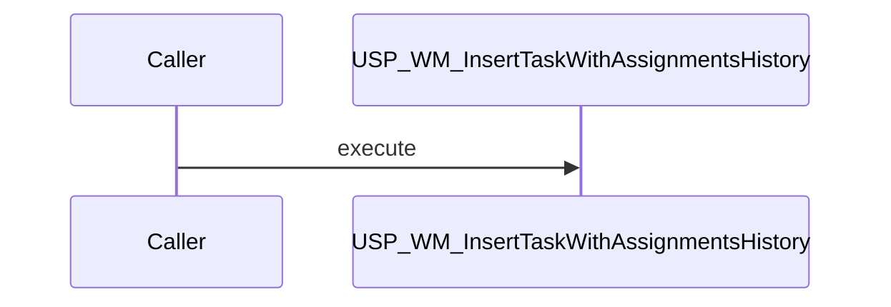
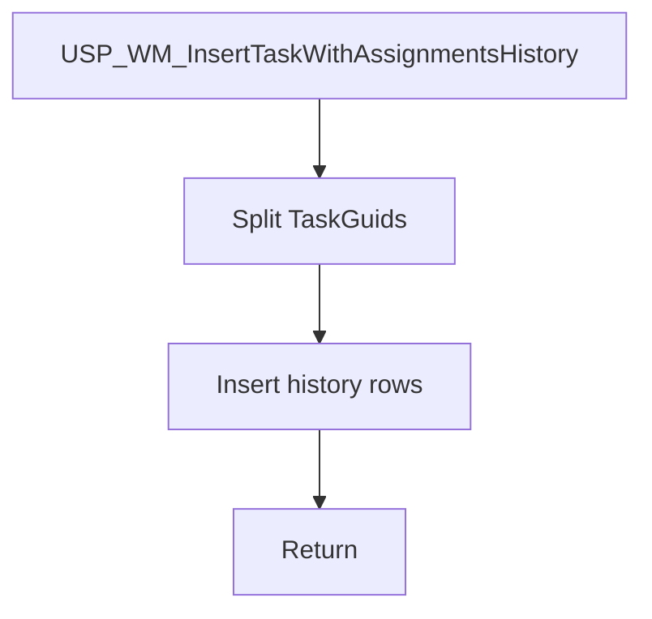

# USP_WM_InsertTaskWithAssignmentsHistory

## What it does

Inserts `TWM_TaskHistory` and `TWM_TaskAssignmentsHistory` rows for a CSV of TaskGuids (optional timeline JSON / UpdatedBy / UpdatedAt).

## Parameters

| Name | Direction | What it is for |
|---|---|---|
| `@TaskGuids` | in | Comma-separated TaskGuid list (`NVARCHAR(MAX)`) |
| `@TimelineRequestJson` | in | Optional timeline JSON (`NVARCHAR(MAX)`, default NULL) |
| `@UpdatedBy` | in | Optional actor id (`INT`, default NULL) |
| `@UpdatedAt` | in | Optional stamp (`DATETIME`, default NULL) |

## Call sequence

## Callers

[`USP_WM_UpsertTaskWithAssignments_V3`](/docs/database/hrm-timeport/USP_WM_UpsertTaskWithAssignments_V3)

## Nested

This object does not execute another procedure.

## Steps

In live DEV `HRM_CL_TIMEPORT.dbo.USP_WM_InsertTaskWithAssignmentsHistory`:

1. Splits `@TaskGuids` into a table variable.
2. Inserts matching `TWM_Task` snapshots into `TWM_TaskHistory`.
3. Inserts matching assignment snapshots into `TWM_TaskAssignmentsHistory`.

## Tables

| Table | Read or write |
|---|---|
| `TWM_Task` | read |
| `TWM_TaskAssignments` | read |
| `TWM_TaskHistory` | write |
| `TWM_TaskAssignmentsHistory` | write |

## Unresolved calls

None.

## Flow

