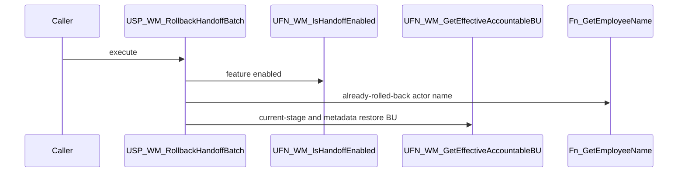
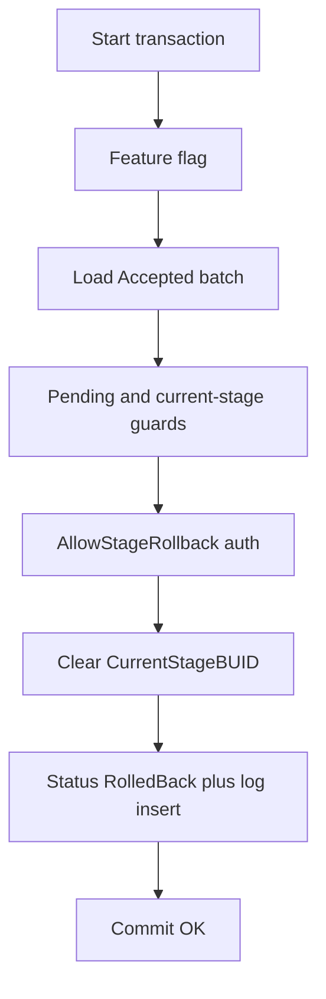

# USP_WM_RollbackHandoffBatch

## What it does

Rolls an **Accepted** Task Batch Handoff back in one transaction: clears `TWM_Task.CurrentStageBUID` for every task in the batch (lazy restore to effective Accountable BU), sets batch `Status = 'RolledBack'`, and inserts a `RolledBack` row into `TWM_StageTransitionLog` with a per-task `MetadataJson` snapshot. Guards feature flag, existence, Accepted-only, pending-overlap (DQ-4), current-stage (DD-17), and `AllowStageRollback` with actor BU = ToBU. Used from Stage Audit when `CanRollback = 1` and from other handoff surfaces.

## Parameters

| Name | Direction | What it is for |
|---|---|---|
| `@HTBGuid` | in | Batch GUID |
| `@Comment` | in | Optional rollback reason (`nvarchar`) |
| `@ActorEmployeeID` | in | Caller employee |
| `@ActorBUID` | in | Caller org BU (must equal ToBU) |
| `@EmployerID` | in | Tenant scope |

## Call sequence

## Callers

No TIMEPORT procedure inventories a call. Application callers: Nest `POST stage-handoff/:htbGuid/rollback` from Stage Audit cards and other HTB UIs ([Stage Audit](/docs/guides/task-management/stage-audit)).

## Nested

| Object | Page |
|---|---|
| `UFN_WM_IsHandoffEnabled` | [UFN_WM_IsHandoffEnabled](/docs/database/hrm-timeport/UFN_WM_IsHandoffEnabled) |
| `UFN_WM_GetEffectiveAccountableBU` | [UFN_WM_GetEffectiveAccountableBU](/docs/database/hrm-timeport/UFN_WM_GetEffectiveAccountableBU) |
| `Fn_GetEmployeeName` | [Fn_GetEmployeeName](/docs/database/hrms/Fn_GetEmployeeName) |

## Steps

1. `BEGIN TRAN`; fail if `UFN_WM_IsHandoffEnabled = 0` (`ERR_FEATURE_DISABLED`).
2. Lock-load batch by GUID + employer; fail `ERR_NOT_FOUND` / `ERR_NOT_ACCEPTED` (status-specific messages).
3. Block if any in-scope task sits in a Pending HTB (`ERR_ROLLBACK_PENDING_EXISTS`).
4. Block if batch is not tasks’ current stage (`ERR_NOT_CURRENT_STAGE` using `UFN_WM_GetEffectiveAccountableBU`).
5. Require `@ActorBUID = ToBU` and System `AllowStageRollback` (`ERR_NOT_AUTHORIZED`).
6. Snapshot metadata JSON; `UPDATE TWM_Task` set `CurrentStageBUID = NULL`; set batch `RolledBack`; insert log event; `COMMIT`; return `OK`.

## Tables

| Table | Access | What it is for |
|---|---|---|
| `TWM_HandoffBatch` | read/write | Status → RolledBack |
| `TWM_HandoffBatchTask` | read | Task set + PriorStageBUID in metadata |
| `TWM_Task` | write | Clear CurrentStageBUID |
| `TWM_StageTransitionLog` | write | RolledBack event |
| `TWM_TAccessGroupMembers` / `TWM_TAccessGroupPermissions` | read | AllowStageRollback |

## Unresolved calls

None beyond nested objects above. This body does **not** call `USP_WM_HTB_EnqueueStageNotifications` (service-layer notify after commit per SystemModel).

## Flow

