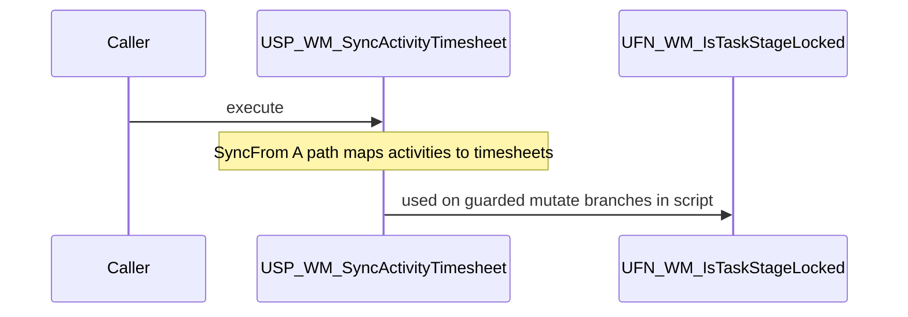
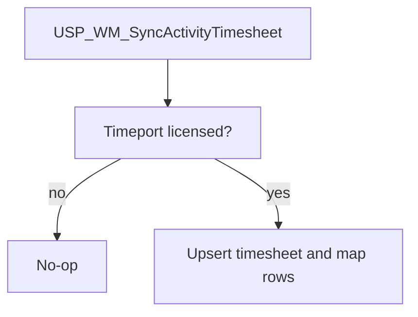

# USP_WM_SyncActivityTimesheet

## What it does

When @SyncFrom = 'A' (activity to timesheet), maps work-log activity ids into Timeport timesheet rows and TWM_TaskActivityTimesheetMap if the employer has an active Timeport licence/module. Nested from USP_WM_UpsertTaskActivityDetail after My Work work-log saves. Also contains stage-lock checks on related mutate paths in the same script.

## Parameters

| Name | Direction | What it is for |
|---|---|---|
| @SyncFrom | in | Direction flag; A means from activity |
| @ActivityIDs | in | UDT of activity ids to sync |

## Call sequence

## Callers

| Object | Kind | Page |
|---|---|---|
| USP_WM_UpsertTaskActivityDetail | procedure | [USP_WM_UpsertTaskActivityDetail](/docs/database/hrm-timeport/USP_WM_UpsertTaskActivityDetail) |

## Nested

| Object | Kind | When | Page |
|---|---|---|---|
| UFN_WM_IsTaskStageLocked | function | guarded branches in script | [UFN_WM_IsTaskStageLocked](/docs/database/hrm-timeport/UFN_WM_IsTaskStageLocked) |

## Steps

1. Resolve assignment, employee, employer, project, and Timeport licence/module for the first activity.
2. If Timeport is enabled for the root employer, upsert/update TTSEmpTimeSheet rows from activity dates/durations and maintain TWM_TaskActivityTimesheetMap.
3. Skip sync when Timeport is not licensed/active.

## Tables

| Table | Read or write |
|---|---|
| TWM_TaskActivityDetail | read |
| TWM_TaskAssignments | read |
| TWM_Task | read |
| TEmployee | read |
| TEmployerDetails | read |
| TTSProjectConfiguration | read |
| THrmsModules | read |
| TLicence | read |
| TEmployerModule | read |
| TTSEmpTimeSheet | write |
| TWM_TaskActivityTimesheetMap | write |

## Flow

