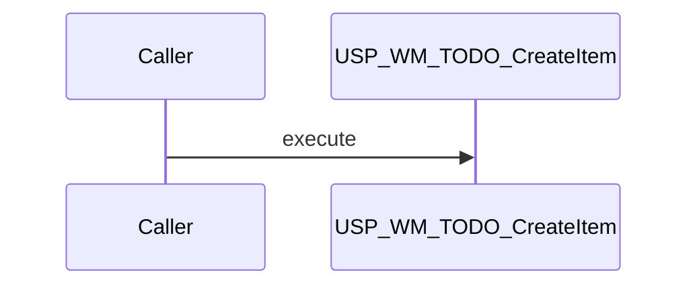
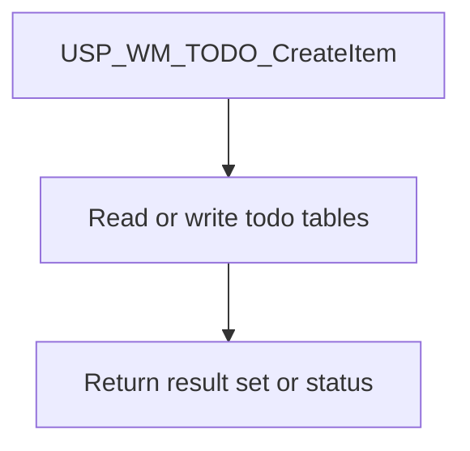

# USP_WM_TODO_CreateItem

## What it does

Inserts a dated or list-owned personal to-do for one employee/employer, appends a `created` event, and returns the new row.

## Parameters

| Name | Direction | What it is for |
|---|---|---|
| `@EmployeeId` | in | INT |
| `@EmployerId` | in | INT |
| `@Title` | in | NVARCHAR |
| `@ScheduledDate` | in | DATE (default NULL) |
| `@TodoListId` | in | INT (default NULL) |
| `@RecurrenceRule` | in | NVARCHAR |
| `@Today` | in | DATE |

## Call sequence

## Callers

Application callers are expected from the My Planner Vite SPA / Work Management `/todo` API (SPA and API sources are not in this SourceCode checkout). `TDataCatalog` maps My Planner to these `USP_WM_TODO_*` objects. No peer procedure nested-call into this object was found in the live definitions reviewed for this guide.

## Nested

Calls no other procedures or functions.

## Steps

Live definition in `HRM_CL_TIMEPORT` (script not checked into Liquibase):

1. Validate exactly one home (`ScheduledDate` xor `TodoListId`).
2. Compute next `Position` in that home.
3. Insert `TWM_TodoItems` and a `created` row in `TWM_TodoItemEvents`.
4. Select the new item.

## Tables

| Table | Read or write |
|---|---|
| `TWM_TodoItems` | write |
| `TWM_TodoItemEvents` | write |

## Unresolved calls

None.

## Flow

