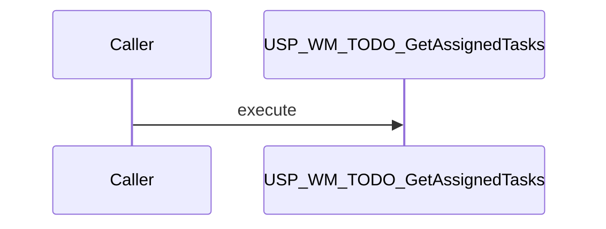
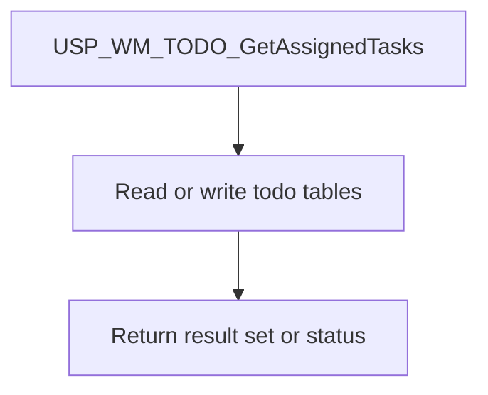

# USP_WM_TODO_GetAssignedTasks

## What it does

Read-only Work Management task chips for My Planner when both planned dates are set (status from `TWM_Task`).

## Parameters

| Name | Direction | What it is for |
|---|---|---|
| `@Today` | in | by |
| `@EmployeeId` | in | INT |
| `@EmployerId` | in | INT |
| `@FromDate` | in | DATE |
| `@ToDate` | in | DATE |
| `@Today` | in | DATE |

## Call sequence

## Callers

Application callers are expected from the My Planner Vite SPA / Work Management `/todo` API (SPA and API sources are not in this SourceCode checkout). `TDataCatalog` maps My Planner to these `USP_WM_TODO_*` objects. No peer procedure nested-call into this object was found in the live definitions reviewed for this guide.

## Nested

Calls no other procedures or functions.

## Steps

Live definition in `HRM_CL_TIMEPORT` (script not checked into Liquibase):

1. Join `TWM_Task` to assignments, status reference, project, and BU mapping.
2. Filter to assignments for the employee with both planned dates overlapping the window.
3. Flag overdue incomplete tasks.

## Tables

| Table | Read or write |
|---|---|
| `TWM_Task` | read |
| `TWM_TaskAssignments` | read |
| `TProject` | read |
| `TWM_ReferenceMaster` | read |
| `TClientProjectMapping` | read |
| `TClient` | read |
| `TClientBusinessUnitMapping` | read |
| `TOrgHierarchyDetails` | read |

## Unresolved calls

None.

## Flow

