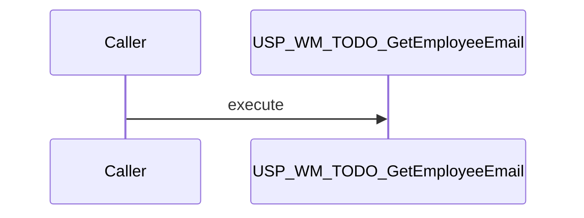
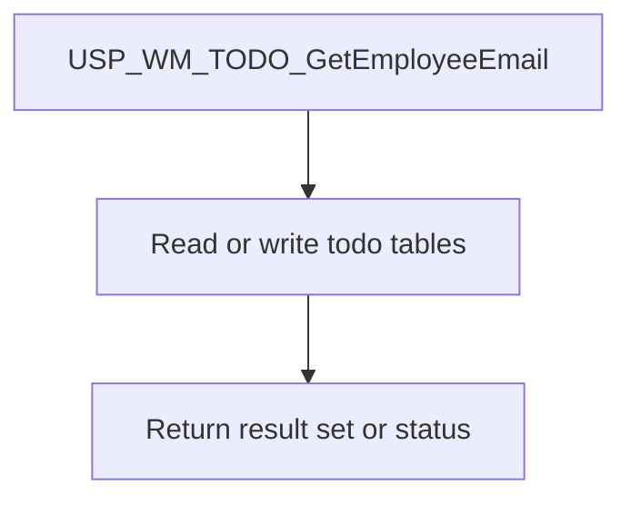

# USP_WM_TODO_GetEmployeeEmail

## What it does

Returns the employee mailbox EmailID only when unique/active for Graph meeting lookup; otherwise no row.

## Parameters

| Name | Direction | What it is for |
|---|---|---|
| `@EmployeeId` | in | INT |
| `@EmployerId` | in | INT |

## Call sequence

## Callers

Application callers are expected from the My Planner Vite SPA / Work Management `/todo` API (SPA and API sources are not in this SourceCode checkout). `TDataCatalog` maps My Planner to these `USP_WM_TODO_*` objects. No peer procedure nested-call into this object was found in the live definitions reviewed for this guide.

## Nested

Calls no other procedures or functions.

## Steps

Live definition in `HRM_CL_TIMEPORT` (script not checked into Liquibase):

1. Join `TEmployee` / `TEmployeeInfo` (HRMS synonyms).
2. Return trimmed EmailID only when active, soft-delete clear, and uniquely held.

## Tables

| Table | Read or write |
|---|---|
| `TEmployee` | read |
| `TEmployeeInfo` | read |

## Unresolved calls

None.

## Flow

