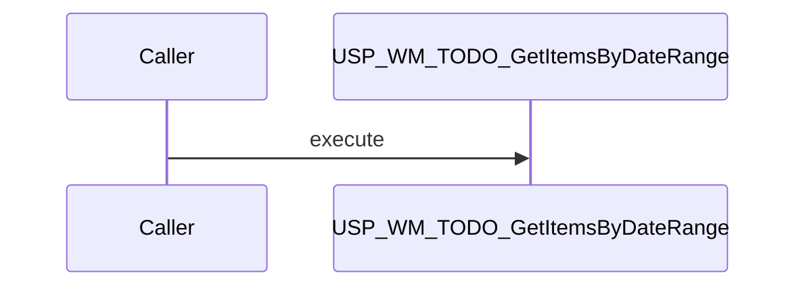
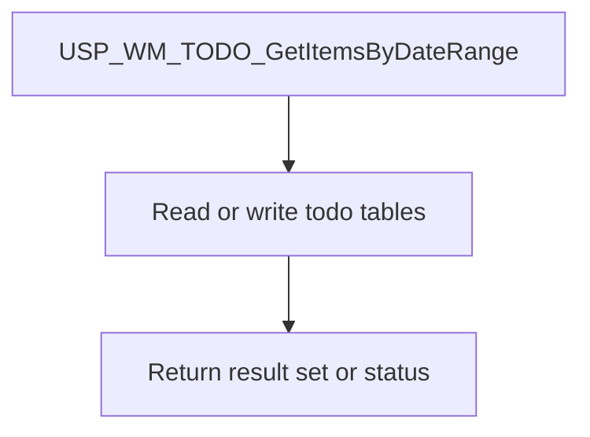

# USP_WM_TODO_GetItemsByDateRange

## What it does

Returns dated personal to-dos in a week window, including series rule from the recurrence parent when needed.

## Parameters

| Name | Direction | What it is for |
|---|---|---|
| `@EmployeeId` | in | INT |
| `@EmployerId` | in | INT |
| `@FromDate` | in | DATE |
| `@ToDate` | in | DATE |

## Call sequence

## Callers

Application callers are expected from the My Planner Vite SPA / Work Management `/todo` API (SPA and API sources are not in this SourceCode checkout). `TDataCatalog` maps My Planner to these `USP_WM_TODO_*` objects. No peer procedure nested-call into this object was found in the live definitions reviewed for this guide.

## Nested

Calls no other procedures or functions.

## Steps

Live definition in `HRM_CL_TIMEPORT` (script not checked into Liquibase):

1. Select non-deleted dated items for the employee in `@FromDate`..`@ToDate`.
2. Left join recurrence parent for `SeriesRule`.
3. Order by date, incomplete first, then position.

## Tables

| Table | Read or write |
|---|---|
| `TWM_TodoItems` | read |

## Unresolved calls

None.

## Flow

