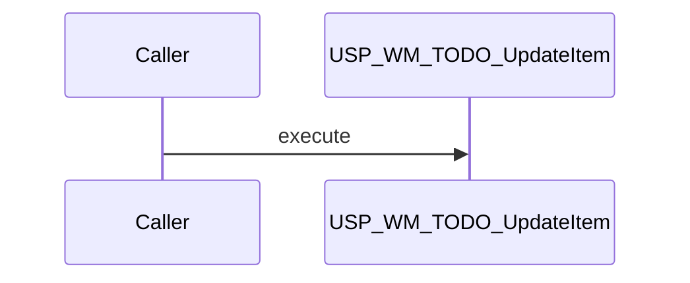
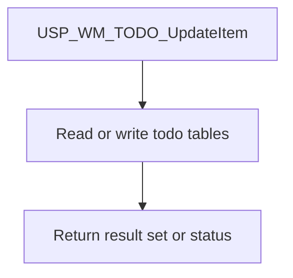

# USP_WM_TODO_UpdateItem

## What it does

Updates title, completion, optional move (date vs list), position, and/or recurrence on one owned to-do; writes matching audit events.

## Parameters

| Name | Direction | What it is for |
|---|---|---|
| `@TodoItemId` | in | INT |
| `@EmployeeId` | in | INT |
| `@EmployerId` | in | INT |
| `@Title` | in | NVARCHAR |
| `@Completed` | in | BIT (default NULL) |
| `@ApplyMove` | in | BIT (default 0) |
| `@ScheduledDate` | in | DATE (default NULL) |
| `@TodoListId` | in | INT (default NULL) |
| `@Position` | in | FLOAT (default NULL) |
| `@ApplyRecurrence` | in | BIT (default 0) |
| `@RecurrenceRule` | in | NVARCHAR |
| `@Today` | in | DATE (default NULL) |

## Call sequence

## Callers

Application callers are expected from the My Planner Vite SPA / Work Management `/todo` API (SPA and API sources are not in this SourceCode checkout). `TDataCatalog` maps My Planner to these `USP_WM_TODO_*` objects. No peer procedure nested-call into this object was found in the live definitions reviewed for this guide.

## Nested

Calls no other procedures or functions.

## Steps

Live definition in `HRM_CL_TIMEPORT` (script not checked into Liquibase):

1. Optionally validate move home exclusivity when `@ApplyMove = 1`.
2. Update matching non-deleted owned row (title, completion, move, position, recurrence).
3. Insert audit events for completed/moved/updated as applicable.

## Tables

| Table | Read or write |
|---|---|
| `TWM_TodoItems` | write |
| `TWM_TodoItemEvents` | write |

## Unresolved calls

None.

## Flow

