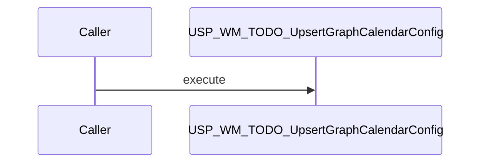
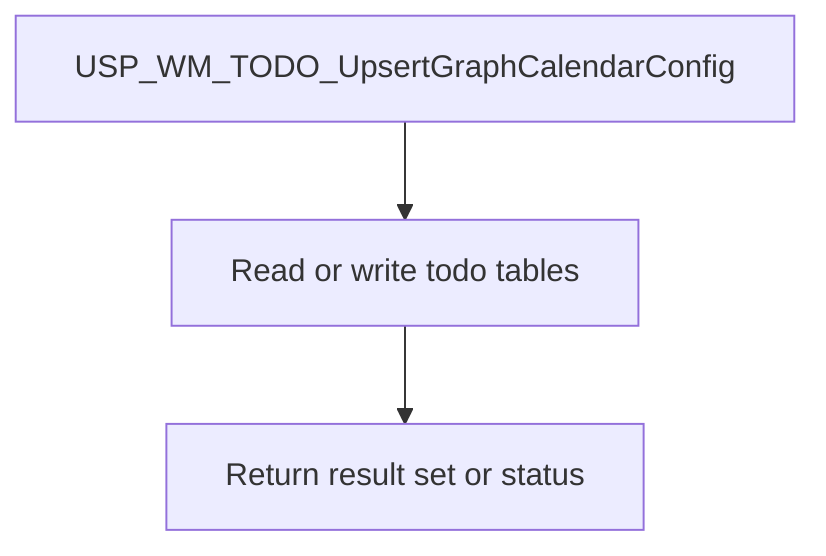

# USP_WM_TODO_UpsertGraphCalendarConfig

## What it does

Idempotent MERGE of employer Graph tenant/client/secret settings used by Meeting Invites.

## Parameters

| Name | Direction | What it is for |
|---|---|---|
| `@EmployerId` | in | INT |
| `@GraphTenantId` | in | UNIQUEIDENTIFIER |
| `@GraphClientId` | in | UNIQUEIDENTIFIER |
| `@ClientSecretEncrypted` | in | NVARCHAR |
| `@SecretExpiresOn` | in | DATE (default NULL) |
| `@WindowsTimeZone` | in | NVARCHAR |
| `@IanaTimeZone` | in | NVARCHAR |
| `@IsEnabled` | in | BIT (default 1) |
| `@ModifiedBy` | in | NVARCHAR |

## Call sequence

## Callers

Application callers are expected from the My Planner Vite SPA / Work Management `/todo` API (SPA and API sources are not in this SourceCode checkout). `TDataCatalog` maps My Planner to these `USP_WM_TODO_*` objects. No peer procedure nested-call into this object was found in the live definitions reviewed for this guide.

## Nested

Calls no other procedures or functions.

## Steps

Live definition in `HRM_CL_TIMEPORT` (script not checked into Liquibase):

1. Require secret on first insert.
2. MERGE Graph tenant/client/secret/timezone/enabled flags.

## Tables

| Table | Read or write |
|---|---|
| `TWM_TODO_GraphCalendarConfig` | write |

## Unresolved calls

None.

## Flow

