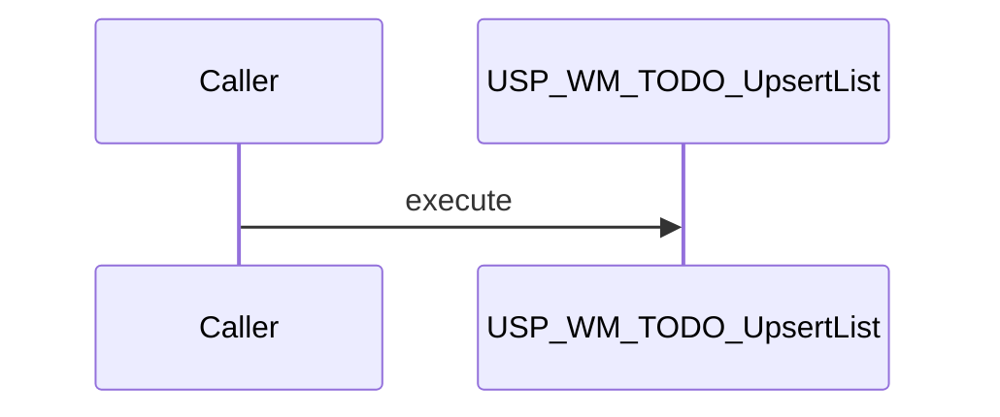
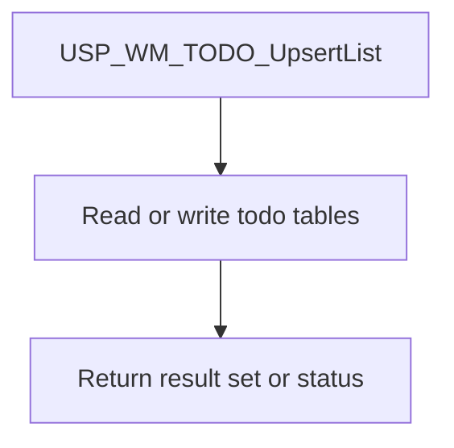

# USP_WM_TODO_UpsertList

## What it does

Creates or renames/repositions a Band 3 Future/Planned list for the employee and returns the list row.

## Parameters

| Name | Direction | What it is for |
|---|---|---|
| `@TodoListId` | in | INT (default NULL) |
| `@EmployeeId` | in | INT |
| `@EmployerId` | in | INT |
| `@Name` | in | NVARCHAR |
| `@Position` | in | FLOAT (default NULL) |

## Call sequence

## Callers

Application callers are expected from the My Planner Vite SPA / Work Management `/todo` API (SPA and API sources are not in this SourceCode checkout). `TDataCatalog` maps My Planner to these `USP_WM_TODO_*` objects. No peer procedure nested-call into this object was found in the live definitions reviewed for this guide.

## Nested

Calls no other procedures or functions.

## Steps

Live definition in `HRM_CL_TIMEPORT` (script not checked into Liquibase):

1. If `@TodoListId` null, insert a new list with next position.
2. Else update name/position on the owned list.
3. Return the list row.

## Tables

| Table | Read or write |
|---|---|
| `TWM_TodoLists` | write |

## Unresolved calls

None.

## Flow

