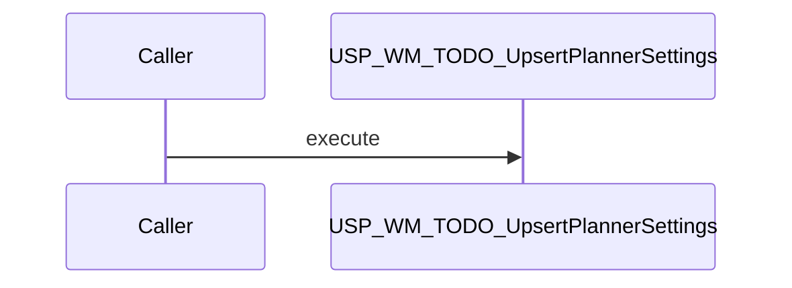
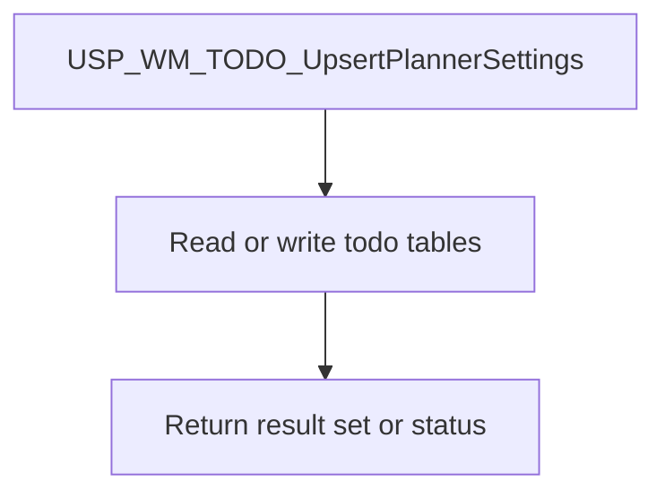

# USP_WM_TODO_UpsertPlannerSettings

## What it does

Merges the employee PlannerDays bitmask (1..127) into `TWM_TODO_PlannerSettings`.

## Parameters

| Name | Direction | What it is for |
|---|---|---|
| `@EmployeeId` | in | INT |
| `@EmployerId` | in | INT |
| `@PlannerDays` | in | INT |

## Call sequence

## Callers

Application callers are expected from the My Planner Vite SPA / Work Management `/todo` API (SPA and API sources are not in this SourceCode checkout). `TDataCatalog` maps My Planner to these `USP_WM_TODO_*` objects. No peer procedure nested-call into this object was found in the live definitions reviewed for this guide.

## Nested

Calls no other procedures or functions.

## Steps

Live definition in `HRM_CL_TIMEPORT` (script not checked into Liquibase):

1. Reject bitmask outside 1..127.
2. MERGE employee/employer settings row.
3. Return saved `PlannerDays`.

## Tables

| Table | Read or write |
|---|---|
| `TWM_TODO_PlannerSettings` | write |

## Unresolved calls

None.

## Flow

