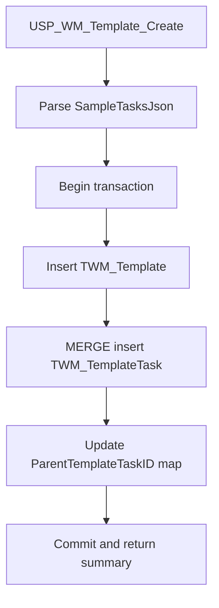

# USP_WM_Template_Create

## What it does

Atomically creates a Project Template header and optional sample-task tree from JSON. Used by Tasks “Save as Template”. Enforces a 1000 sample-task cap and rejects orphaned parent temp ids. Duplicate live names rely on filtered unique index `UQ_TWM_Template_Name` (mapped to HTTP 409 by the API).

## Parameters

| Name | Direction | What it is for |
|---|---|---|
| `@EmployerID` | in | Tenant org for the new template |
| `@EmployeeID` | in | Creator (`CreatedBy`) |
| `@TemplateName` | in | Display name (nvarchar 255) |
| `@Description` | in | Optional description |
| `@SourceProjectID` | in | Informational source project (no FK) |
| `@ColumnsJson` | in | Column snapshot JSON |
| `@SampleTasksJson` | in | Optional OPENJSON sample-task payload; null/empty = structure-only |

## Call sequence

1. Optionally parse and validate `@SampleTasksJson` into a temp table
2. Begin transaction; insert `TWM_Template`
3. MERGE insert sample tasks, then wire `ParentTemplateTaskID` from temp-id map
4. Commit; return summary row

## Callers

No other procedure calls this object. App callers: `TemplatesRepository.create` → `TemplatesController.create` (Save as Template from Tasks), which feeds the [Project Templates](/docs/guides/task-management/project-templates) library.

## Nested

None.

## Steps

1. Definition read from live `HRM_CL_TIMEPORT.dbo.USP_WM_Template_Create`.
2. `SET XACT_ABORT ON`; validate JSON / 1000-row / parent-presence rules with `THROW 50400`.
3. Insert header; MERGE `TWM_TemplateTask` with `ON 1 = 0` so `OUTPUT` can return source `TempId` with new identities.
4. Update parents from temp-id map; commit; select created summary including `SampleTaskCount` and `RowVersion`.

## Tables

| Table | Read or write |
|---|---|
| `TWM_Template` | write |
| `TWM_TemplateTask` | write |

## Unresolved calls

None.

## Flow

