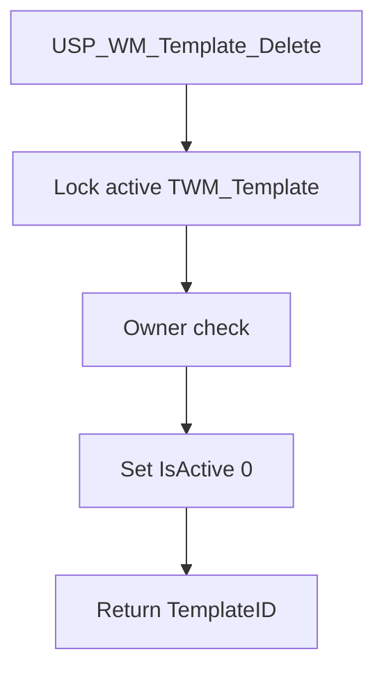

# USP_WM_Template_Delete

## What it does

Soft-deletes a Project Template by setting `IsActive = 0`. Sample tasks are left in place but become unreachable because every reader joins active headers only. Owner-only (`50403`); missing/wrong-tenant returns `50404`. Filtered unique name index frees the name for reuse.

## Parameters

| Name | Direction | What it is for |
|---|---|---|
| `@TemplateID` | in | Template to soft-delete |
| `@EmployerID` | in | Template’s employer |
| `@EmployeeID` | in | Acting employee (must be `CreatedBy`) |

## Call sequence

1. Lock active template; resolve owner
2. Reject if missing or not owner
3. Update `IsActive = 0` and audit columns
4. Return `TemplateID`

## Callers

No other procedure calls this object. App callers: `TemplatesRepository.remove` → `TemplatesController.remove` from [Project Templates](/docs/guides/task-management/project-templates).

## Nested

None.

## Steps

1. Definition read from live `HRM_CL_TIMEPORT.dbo.USP_WM_Template_Delete`.
2. Transaction with `UPDLOCK, ROWLOCK` on `TWM_Template`.
3. `THROW 50404` / `50403` as needed.
4. Soft-delete update; commit; select `@TemplateID`.

## Tables

| Table | Read or write |
|---|---|
| `TWM_Template` | read/write |
| `TWM_TemplateTask` | unchanged (orphaned under inactive header) |

## Unresolved calls

None.

## Flow

