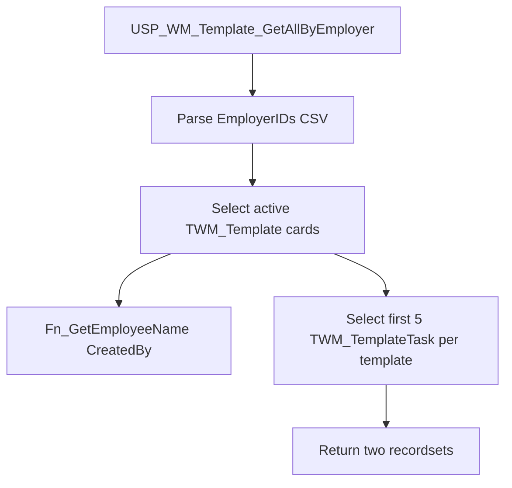

# USP_WM_Template_GetAllByEmployer

## What it does

Returns the Project Templates library for one or more employers in two recordsets: active template cards (with column snapshot, creator name, sample-task count, rowversion) and up to five preview sample tasks per template for card thumbnails. Optional `scope=mine` limits cards to templates created by `@EmployeeID`.

## Parameters

| Name | Direction | What it is for |
|---|---|---|
| `@EmployerIDs` | in | CSV of employer ids (caller expands `-1` / All Organizations before calling) |
| `@EmployeeID` | in | Current employee; used when `@Scope = 'mine'` |
| `@Scope` | in | `'all'` (default) or `'mine'` |

## Call sequence

1. Split `@EmployerIDs` into a table variable
2. Select active `TWM_Template` rows for those employers (optional owner filter)
3. Select top 5 `TWM_TemplateTask` rows per matching template for preview

## Callers

No other procedure calls this object. App callers: `TemplatesRepository.list` → `TemplatesController.list` from [Project Templates](/docs/guides/task-management/project-templates).

## Nested

| Object | When |
|---|---|
| `Fn_GetEmployeeName` | `CreatedByName` on each card |

## Steps

1. Definition read from live `HRM_CL_TIMEPORT.dbo.USP_WM_Template_GetAllByEmployer`.
2. Parse CSV employers via `STRING_SPLIT` / `TRY_CONVERT`.
3. Recordset 1 — active templates joined to employer set; `SampleTaskCount` subquery; order by latest activity.
4. Recordset 2 — `ROW_NUMBER` over sample tasks per template, keep `rn <= 5`.

## Tables

| Table | Read or write |
|---|---|
| `TWM_Template` | read |
| `TWM_TemplateTask` | read |

## Unresolved calls

None.

## Flow

