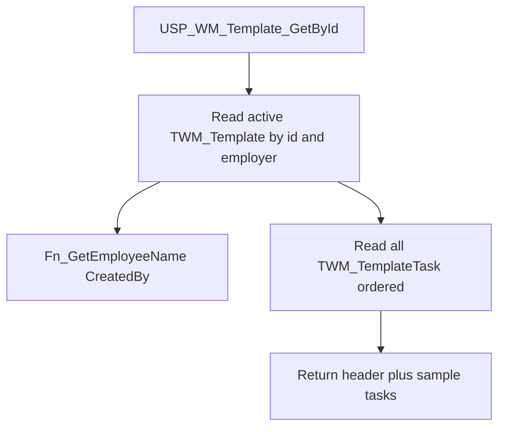

# USP_WM_Template_GetById

## What it does

Loads one active template for an employer: header (including full `ColumnsJson`) plus every sample task in display order. Used by View, Edit, stale-card checks, and TimePort preview. A wrong-tenant or inactive id returns empty result sets (indistinguishable from missing).

## Parameters

| Name | Direction | What it is for |
|---|---|---|
| `@TemplateID` | in | Template primary key |
| `@EmployerID` | in | Hard tenant predicate (template’s own org) |

## Call sequence

1. Select header from `TWM_Template` for id + employer + `IsActive = 1`
2. Select all `TWM_TemplateTask` rows for that template (joined through active header)

## Callers

No other procedure calls this object. App callers: `TemplatesRepository.getById` → `TemplatesController.getById` from [Project Templates](/docs/guides/task-management/project-templates).

## Nested

| Object | When |
|---|---|
| `Fn_GetEmployeeName` | `CreatedByName` on header |

## Steps

1. Definition read from live `HRM_CL_TIMEPORT.dbo.USP_WM_Template_GetById`.
2. Header select includes `ColumnsJson`, sample-task count, and `RowVersion` as `bigint`.
3. Sample-task select returns tree fields only (title, description, custom fields JSON, parent, sort) — no status/schedule/assignee columns exist on the table.

## Tables

| Table | Read or write |
|---|---|
| `TWM_Template` | read |
| `TWM_TemplateTask` | read |

## Unresolved calls

None.

## Flow

