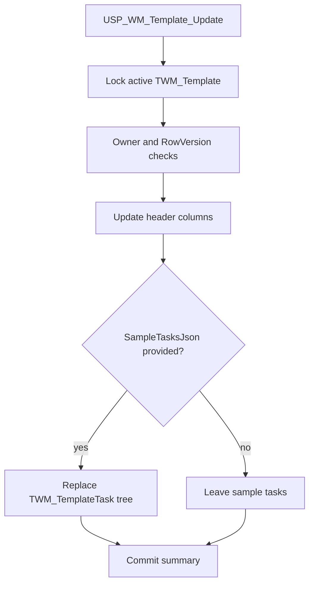

# USP_WM_Template_Update

## What it does

Owner-only in-place update of a Project Template. Optionally replaces the entire sample-task set when `@SampleTasksJson` is supplied; null leaves tasks untouched. Enforces ownership (`50403`), not-found (`50404`), and optimistic concurrency via `@RowVersion` (`50409`). Unlike create, there is no 1000-task cap on edit.

## Parameters

| Name | Direction | What it is for |
|---|---|---|
| `@TemplateID` | in | Template to update |
| `@EmployerID` | in | Template’s employer |
| `@EmployeeID` | in | Acting employee (must be `CreatedBy`) |
| `@TemplateName` | in | New name, or null to leave |
| `@Description` | in | New description, or null to leave |
| `@ColumnsJson` | in | New column snapshot, or null to leave |
| `@SampleTasksJson` | in | Full sample-task replace JSON, or null to leave tasks |
| `@RowVersion` | in | Expected `RowVersion` as bigint |

## Call sequence

1. Optionally parse `@SampleTasksJson`
2. Lock active template row; check owner and rowversion
3. Update header fields that were supplied
4. If sample JSON present, clear and re-insert task tree
5. Return summary row

## Callers

No other procedure calls this object. App callers: `TemplatesRepository.update` → `TemplatesController.update` from [Project Templates](/docs/guides/task-management/project-templates).

## Nested

None.

## Steps

1. Definition read from live `HRM_CL_TIMEPORT.dbo.USP_WM_Template_Update`.
2. `UPDLOCK, ROWLOCK` select of `CreatedBy` / `RowVersion`.
3. `THROW` on missing, non-owner, or stale version.
4. Update `TWM_Template`; when sample JSON provided, null parents, delete tasks, MERGE re-insert, rewire parents.
5. Commit and select updated summary.

## Tables

| Table | Read or write |
|---|---|
| `TWM_Template` | read/write |
| `TWM_TemplateTask` | read/write |

## Unresolved calls

None.

## Flow

