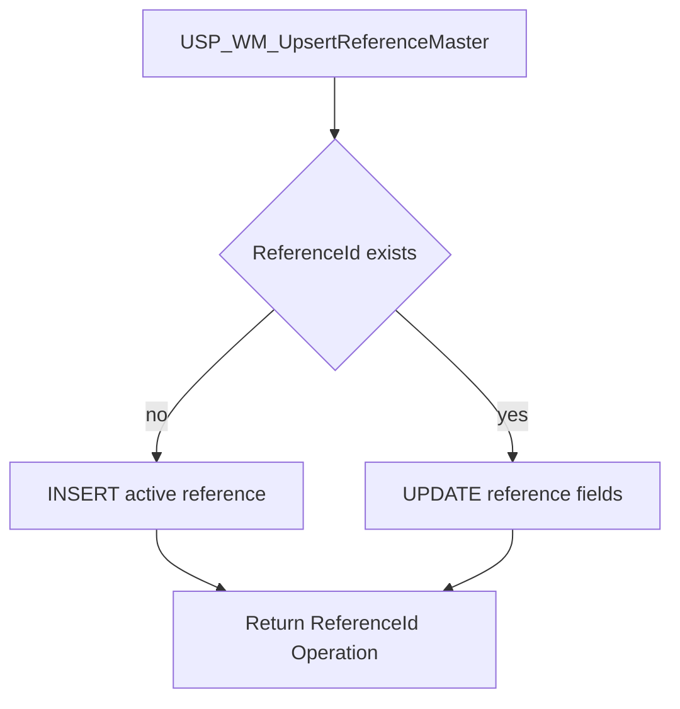

# USP_WM_UpsertReferenceMaster

## What it does

Inserts or updates one `TWM_ReferenceMaster` row for Configuration → **REFERENCE DATA**. Null or unknown `@ReferenceId` inserts with `IsActive = 1` and UTC `CreatedAt`. Existing id updates name, color, order, hierarchy (`RefID` / `ParentID`), BU, sequence, and UTC audit. Returns `ReferenceId`, `Operation`, and a message.

## Parameters

| Name | Direction | What it is for |
|---|---|---|
| `@ReferenceId` | in | Null = insert; else update key |
| `@EmployerId` | in | Owning employer |
| `@ProjectId` | in | Optional project scope |
| `@ReferenceName` | in | Display name |
| `@ColorCode` | in | Optional color |
| `@DisplayOrder` | in | Optional display order |
| `@RefID` | in | Reference type id |
| `@ParentID` | in | Parent reference id |
| `@BusinessUnitID` | in | Business unit scope |
| `@EmployeeId` | in | CreatedBy / UpdatedBy |
| `@SequenceNumber` | in | Sequence within type |

## Call sequence

Calls no other procedures or functions.

## Callers

Application caller: Work Management API upsert for Configuration → REFERENCE DATA.

## Nested

Calls no other procedures or functions.

## Steps

1. If `@ReferenceId` is null or missing, `INSERT` active row with UTC create audit.
2. Else `UPDATE` the row's editable columns and UTC update audit (`IsActive` unchanged).
3. Return `ReferenceId`, `Operation`, and success message.

## Tables

| Table | Read or write |
|---|---|
| `dbo.TWM_ReferenceMaster` | read and write |

## Flow

