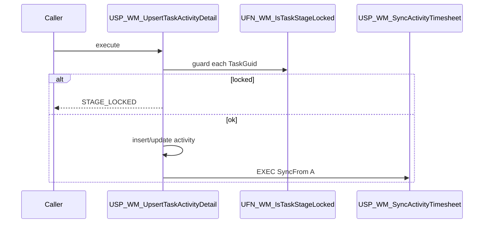
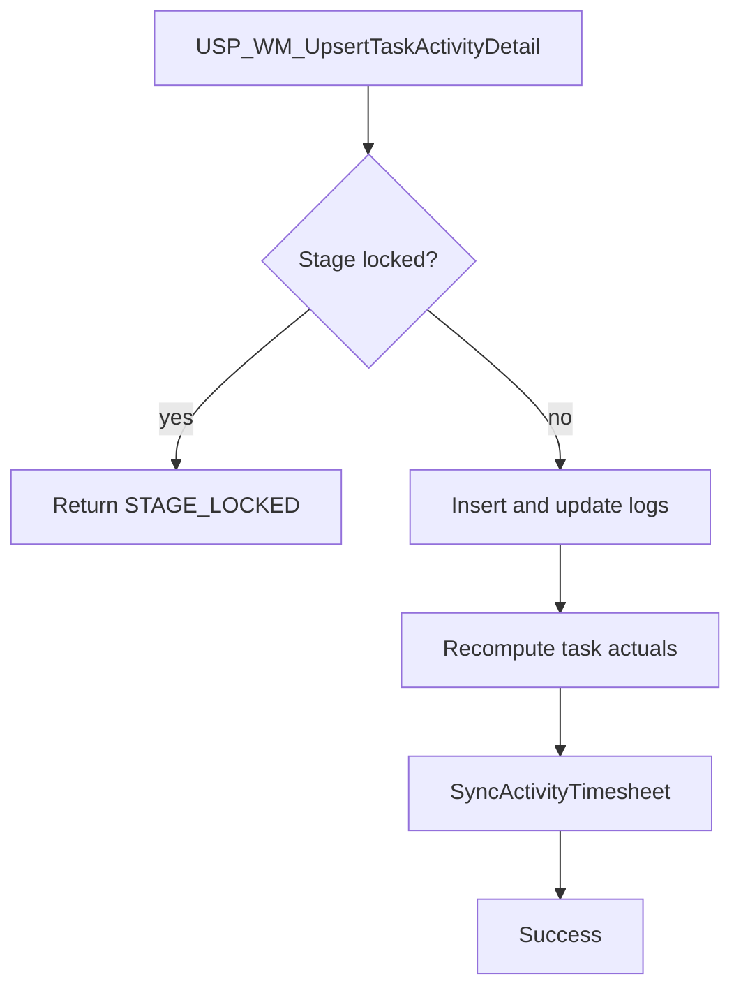

# USP_WM_UpsertTaskActivityDetail

## What it does

Bulk inserts and updates work-log rows from UDT UDT_WM_TaskActivity. Refuses changes when any task is stage-locked. Recomputes task actual start/end/duration from remaining active logs (excluding deactivated employees), then syncs Timeport timesheets. Used by Nest POST /tasks/activity-detail from the My Work Work Log tab.

## Parameters

| Name | Direction | What it is for |
|---|---|---|
| @Activities | in | Read-only UDT of activity rows to insert/update |

## Call sequence

## Callers

No other procedure or function executes this object. Application caller: Nest tasks activity-detail POST.

## Nested

| Object | Kind | When | Page |
|---|---|---|---|
| UFN_WM_IsTaskStageLocked | function | before mutate | [UFN_WM_IsTaskStageLocked](/docs/database/hrm-timeport/UFN_WM_IsTaskStageLocked) |
| USP_WM_SyncActivityTimesheet | procedure | after insert/update | [USP_WM_SyncActivityTimesheet](/docs/database/hrm-timeport/USP_WM_SyncActivityTimesheet) |

## Steps

1. If any distinct TaskGuid in the UDT is stage-locked, return STAGE_LOCKED and stop.
2. Insert rows with null/missing ActivityID; update existing ActivityID rows.
3. Recompute TWM_Task actual dates/duration from active logs whose assignees are still active employees.
4. EXEC USP_WM_SyncActivityTimesheet @SyncFrom='A' for inserted/updated activity ids.
5. Return Success.

## Tables

| Table | Read or write |
|---|---|
| TWM_TaskActivityDetail | write |
| TWM_Task | write |
| TWM_TaskAssignments | read |
| TEmployee | read |

## Flow

