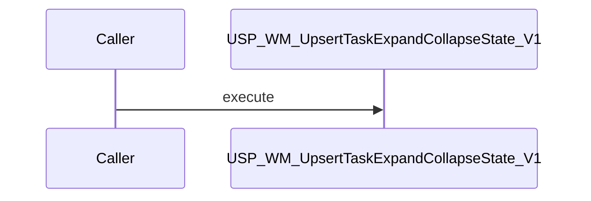
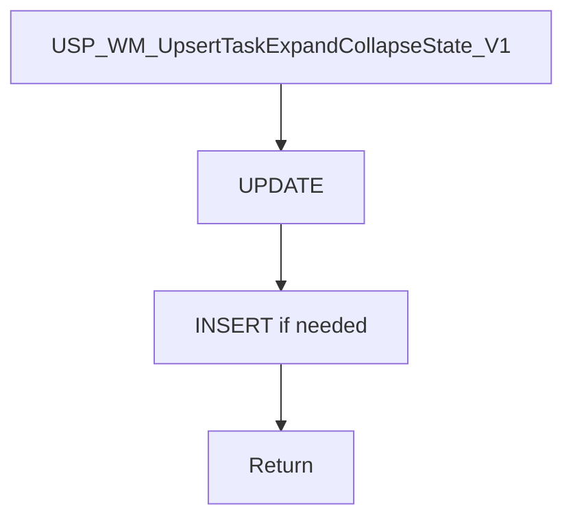

# USP_WM_UpsertTaskExpandCollapseState_V1

## What it does

Updates or inserts `TWM_TaskExpandCollapseState` for the caller expand/collapse set on a page type.

## Parameters

| Name | Direction | What it is for |
|---|---|---|
| `@EmployerId` | in | Employer id (`INT`) |
| `@ProjectId` | in | Project id (`INT`) |
| `@EmployeeId` | in | Employee id (`INT`) |
| `@BusinessUnitId` | in | Business unit id (`INT`) |
| `@ExpandedTaskIds` | in | Serialized expanded ids (`NVARCHAR(MAX)`) |
| `@PageType` | in | Page key (`VARCHAR(50)`) |

## Call sequence

## Callers

Catalog expand-collapse persistence for Tasks.

## Nested

This object does not execute another procedure.

## Steps

In live DEV `HRM_CL_TIMEPORT.dbo.USP_WM_UpsertTaskExpandCollapseState_V1`:

1. Updates matching `TWM_TaskExpandCollapseState` row.
2. If no row updated, inserts a new row with UTC timestamps.

## Tables

| Table | Read or write |
|---|---|
| `TWM_TaskExpandCollapseState` | write |

## Unresolved calls

None.

## Flow

