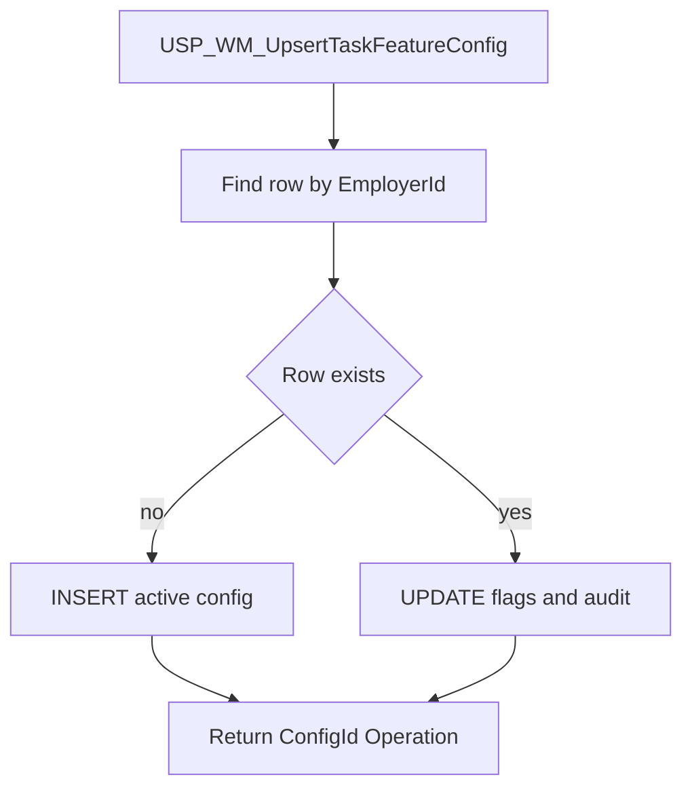

# USP_WM_UpsertTaskFeatureConfig

## What it does

Inserts or updates the employer's `TWM_TaskFeatureConfig` row for Task Management **TASK SETUP**. Upserts against the requested `@EmployerId` (not the acting user's root). On insert, `IsActive` is always 1 and `CreatedAt` is UTC. On update, `NotificationFlags` uses `ISNULL(@NotificationFlags, NotificationFlags)` so omitted JSON does not wipe stored choices. Returns `ConfigId`, `Operation` (`INSERT`/`UPDATE`), and a message.

## Parameters

| Name | Direction | What it is for |
|---|---|---|
| `@ConfigId` | in | Legacy; existence is resolved by `EmployerId` |
| `@EmployerId` | in | Employer being configured |
| `@ProjectId` | in | Optional project scope |
| `@TaskCreator` | in | Who may create tasks (default anyone-to-anyone) |
| `@AllowSubtasks` | in | Subtask switch |
| `@AllowMultipleAssignees` | in | Multiple assignees switch |
| `@AllowTimeportConnectivity` | in | TimePort connectivity switch |
| `@AllowDefaultStatus` | in | Default status switch |
| `@EnableTaskEvaluation` | in | Evaluation switch |
| `@AllowDefaultEvaluationGrade` | in | Default grade switch |
| `@AllowDefaultPriority` | in | Default priority switch |
| `@MultipleProjectSelection` | in | Multi-project selection switch |
| `@AllowTaskBatchHandoff` | in | Batch handoff switch (default off) |
| `@NotificationFlags` | in | Optional JSON of notification on/off choices |
| `@EmployeeId` | in | Actor for CreatedBy / UpdatedBy |

## Call sequence

Calls no other procedures or functions.

## Callers

Application caller: Work Management API upsert for Configuration → TASK SETUP. Header comments note notification producers and handoff guards read related config via `UFN_WM_IsNotificationEnabled` / `UFN_WM_IsHandoffEnabled`, not by calling this procedure.

## Nested

Calls no other procedures or functions.

## Steps

1. Look up existing `ConfigId` for `@EmployerId` on `TWM_TaskFeatureConfig`.
2. If none, `INSERT` a new active row with all feature columns and `@NotificationFlags`, `CreatedBy = @EmployeeId`, `CreatedAt = GETUTCDATE()`.
3. Else `UPDATE` that row's feature columns; set `NotificationFlags = ISNULL(@NotificationFlags, NotificationFlags)`; set `UpdatedBy` / `UpdatedAt` UTC.
4. Return `ConfigId`, `Operation`, and success message.

## Tables

| Table | Read or write |
|---|---|
| `dbo.TWM_TaskFeatureConfig` | read and write |

## Flow

