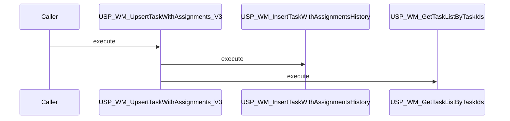
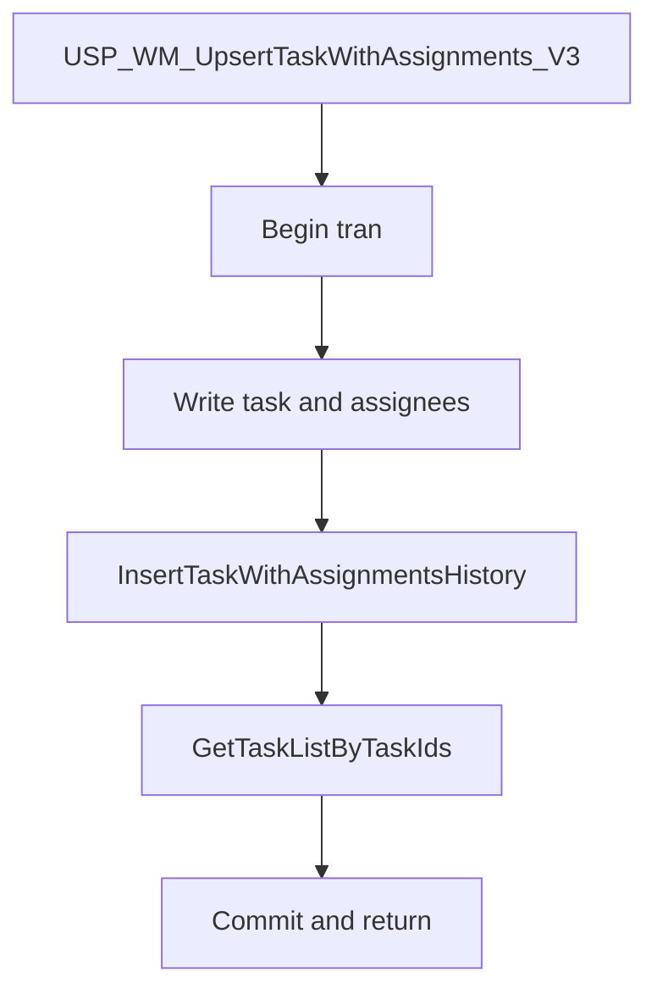

# USP_WM_UpsertTaskWithAssignments_V3

## What it does

Transactional create/update of tasks and assignees from `UDT_WM_TaskWithAssignment_V3`. Writes `TWM_Task` / `TWM_TaskAssignments` (and related), then nests history insert and returns refreshed rows via `USP_WM_GetTaskListByTaskIds`.

## Parameters

| Name | Direction | What it is for |
|---|---|---|
| `@TaskData` | in | Table-valued `UDT_WM_TaskWithAssignment_V3` READONLY |

## Call sequence

## Callers

Work Management Tasks save (catalog). Exact API caller not in SourceCode checkout.

## Nested

| Object | Kind |
|---|---|
| [`USP_WM_InsertTaskWithAssignmentsHistory`](/docs/database/hrm-timeport/USP_WM_InsertTaskWithAssignmentsHistory) | procedure |
| [`USP_WM_GetTaskListByTaskIds`](/docs/database/hrm-timeport/USP_WM_GetTaskListByTaskIds) | procedure |

## Steps

In live DEV `HRM_CL_TIMEPORT.dbo.USP_WM_UpsertTaskWithAssignments_V3`:

1. Opens a transaction and stages `@TaskData` into `#TaskData`.
2. Inserts/updates `TWM_Task` and assignee rows (and related task fields).
3. Nests `USP_WM_InsertTaskWithAssignmentsHistory` for changed guids.
4. Nests `USP_WM_GetTaskListByTaskIds` to return upserted rows.
5. Commits (rolls back / throws on failure).

## Tables

| Table | Read or write |
|---|---|
| `TWM_Task` | write |
| `TWM_TaskAssignments` | write |
| `TWM_Threads` | write |
| `TPROJECT` / `TProject` | read |

## Unresolved calls

None beyond the nested procedures above.

## Flow

