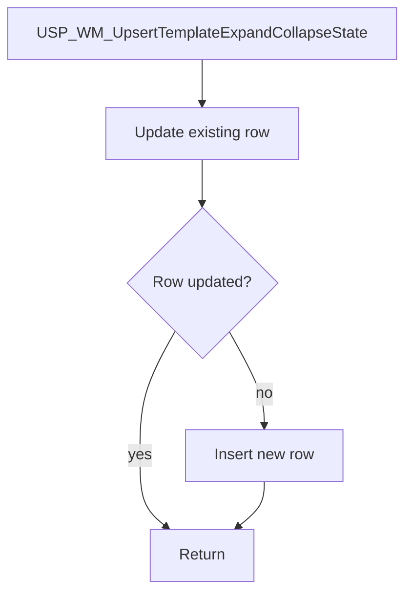

# USP_WM_UpsertTemplateExpandCollapseState

## What it does

Update-else-insert of a viewer’s expand/collapse id JSON for a template Edit tree. UI-only preference; not part of the template snapshot itself.

## Parameters

| Name | Direction | What it is for |
|---|---|---|
| `@EmployerId` | in | Tenant |
| `@TemplateId` | in | Template being edited |
| `@EmployeeId` | in | Viewer |
| `@ExpandedTaskIds` | in | JSON string of expanded row ids |

## Call sequence

1. Update matching row’s `ExpandedTaskIds` / `UpdatedAt`
2. If no row updated, insert a new row with UTC timestamps

## Callers

No other procedure calls this object. App callers: `TemplatesRepository.saveExpandCollapseState` → `TemplatesController.saveExpandCollapseState` from [Project Templates](/docs/guides/task-management/project-templates).

## Nested

None.

## Steps

1. Definition read from live `HRM_CL_TIMEPORT.dbo.USP_WM_UpsertTemplateExpandCollapseState`.
2. Update by employer/template/employee.
3. Insert when `@@ROWCOUNT = 0`. There is no unique constraint on the triple in the entity notes.

## Tables

| Table | Read or write |
|---|---|
| `TWM_TemplateExpandCollapseState` | read/write |

## Unresolved calls

None.

## Flow

