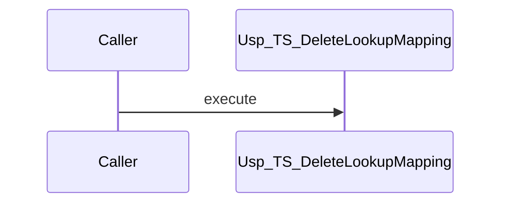
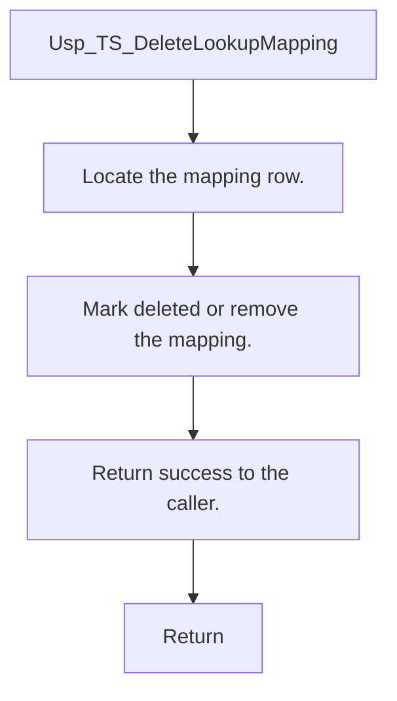

# Usp_TS_DeleteLookupMapping

## What it does

Deletes or soft-deletes TimePort lookup mapping rows used by Manage Reference Data.

## Parameters

| Name | Direction | What it is for |
|---|---|---|
| `@TTSLookUpMappingID` | in | Mapping id from request |
| `@LoginUserID` | in | Acting employee id |

## Call sequence

## Callers

Application only. timeportDAL.DeleteLookupMapping.

## Nested

This object does not execute another procedure or user-defined function.

## Steps

In `HRMS-DATABASE/HRM-TIMEPORT/STOREPROCEDURE/Usp_TS_DeleteLookupMapping.sql`:

1. Locate the mapping row.
2. Mark deleted or remove the mapping.
3. Return success to the caller.

## Tables

| Table | Read or write |
|---|---|
| `TTSLookUpMapping` | write |

## Unresolved calls

None recorded for this page.

## Flow

