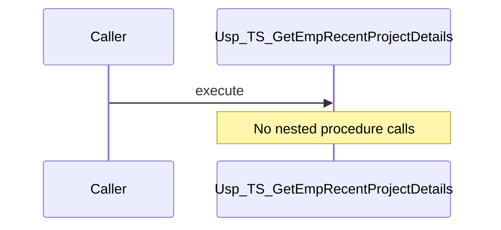
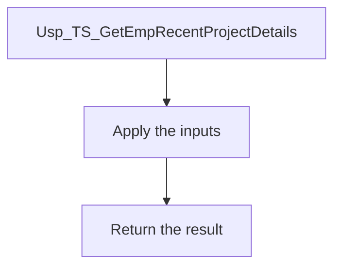

# Usp_TS_GetEmpRecentProjectDetails

## What it does

Returns the most recent timesheet project row for an employee (TOP 1) to seed Daily/Weekly entry when starting a new day/week.

## Parameters

| Name | Direction | What it is for |
|---|---|---|
| `@pEmployerId` | in | Employer id |
| `@pEmployeeId` | in | Employee id |
| `@PStartDate` | in | Reference date |

## Call sequence

## Callers

Application caller: TimePort API `GetEmpRecentProjectDetails` for TimePort → TimeSheet.

## Nested

| Object | Kind | When | Page |
|---|---|---|---|
| _(none)_ | — | — | — |

## Steps

In `HRMS-DATABASE/HRM-TIMEPORT/STOREPROCEDURE/Usp_TS_GetEmpRecentProjectDetails.sql`:

1. Select TOP 1 recent `TTSEmpTimeSheet` row with project and lookup names.
2. Include status and editable-by-approver flags for UI seeding.

## Tables

| Table | Read or write |
|---|---|
| `TTSEmpTimeSheet` | read |
| `TProject` | read |
| `TTSLOOKUP` | read |
| `TSEmpTimesheetStatus` | read |

## Unresolved calls

None identified beyond the nested objects listed above.

## Flow

