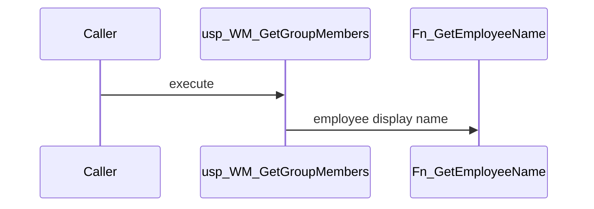
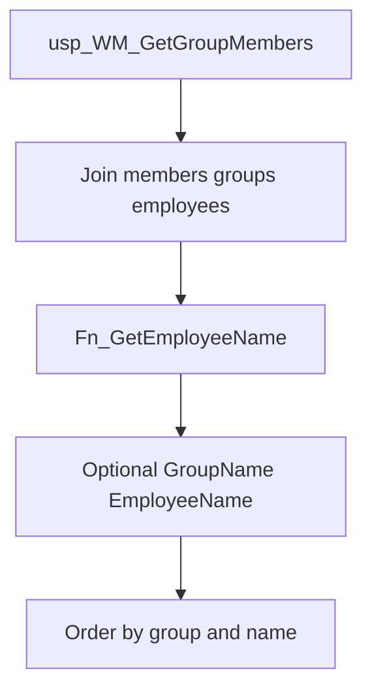

# usp_WM_GetGroupMembers

## What it does

Lists active access-group members for Configuration → **ACCESS GROUPS**. Joins `TWM_TAccessGroupMembers` to `TWM_TAccessGroupPermissions` and `TEmployee`, resolves display names with `Fn_GetEmployeeName`, and optionally filters by group name or employee name substring. Catalog route: `GET /access-groups/members`.

## Parameters

| Name | Direction | What it is for |
|---|---|---|
| `@GroupName` | in | Optional exact group name |
| `@EmployeeName` | in | Optional name substring filter |

## Call sequence

## Callers

Application caller: Work Management API `GET /access-groups/members` for Task Management → Configuration → ACCESS GROUPS.

## Nested

| Object | Kind | When | Page |
|---|---|---|---|
| `Fn_GetEmployeeName` | function | each member row / name filter | [Fn_GetEmployeeName](/docs/database/hrms/Fn_GetEmployeeName) |

## Steps

1. Join active members to their group and `TEmployee`.
2. Project `EmployeeName` via `dbo.Fn_GetEmployeeName`.
3. Optional filters on `GroupName` and name `LIKE`.
4. Order by group name then employee name.

## Tables

| Table | Read or write |
|---|---|
| `dbo.TWM_TAccessGroupMembers` | read |
| `dbo.TWM_TAccessGroupPermissions` | read |
| `dbo.TEmployee` | read |

## Flow

