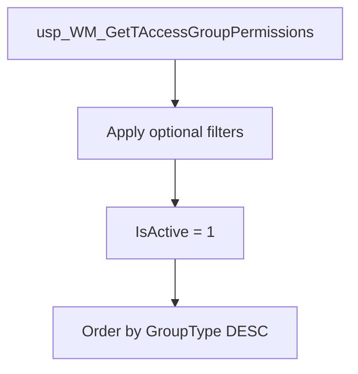

# usp_WM_GetTAccessGroupPermissions

## What it does

Lists active access-group permission rows from `TWM_TAccessGroupPermissions` for Configuration → **ACCESS GROUPS**. Optional filters for group name, type, feature category (Task Handoff / Report Manager / Task Permissions), employer (including employer `0`), project, and business unit. Returns task bits and the three stage bits used by Task Batch Handoff. Ordered by `GroupType` descending. Catalog route: `GET /access-groups`.

## Parameters

| Name | Direction | What it is for |
|---|---|---|
| `@GroupName` | in | Optional exact group name |
| `@GroupType` | in | Optional group type |
| `@FeatureCategory` | in | Optional feature category |
| `@EmployerID` | in | Optional employer (also matches `0`) |
| `@ProjectID` | in | Optional project |
| `@BusinessUnitID` | in | Optional business unit |

## Call sequence

Calls no other procedures or functions.

## Callers

Application caller: Work Management API `GET /access-groups` for Task Management → Configuration → ACCESS GROUPS.

## Nested

Calls no other procedures or functions.

## Steps

1. Select permission and stage-bit columns from `TWM_TAccessGroupPermissions`.
2. Apply optional equality filters; employer filter also allows `ISNULL(EmployerID, 0) = 0`.
3. Restrict to `IsActive = 1`.
4. Order by `GroupType DESC`.

## Tables

| Table | Read or write |
|---|---|
| `dbo.TWM_TAccessGroupPermissions` | read |

## Flow

