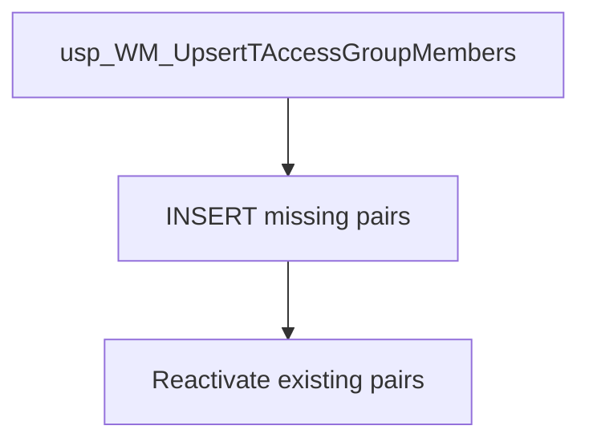

# usp_WM_UpsertTAccessGroupMembers

## What it does

Applies a table-valued list of group members (`UDT_WM_TAccessGroupMembersType`) for Configuration → **ACCESS GROUPS**. Inserts rows that do not already exist (active, audited with `GETDATE()`), and reactivates matching existing rows (`IsActive = 1`) with update audit. Only groups that exist in `TWM_TAccessGroupPermissions` are accepted.

## Parameters

| Name | Direction | What it is for |
|---|---|---|
| `@GroupMembers` | in | Readonly TVP of `GrpID` / `EmployeeID` pairs |

## Call sequence

Calls no other procedures or functions.

## Callers

Application caller: Work Management API member save for Configuration → ACCESS GROUPS.

## Nested

Calls no other procedures or functions.

## Steps

1. `INSERT` new `TWM_TAccessGroupMembers` rows from `@GroupMembers` joined to existing groups when the pair is absent.
2. `UPDATE` matching existing pairs to `IsActive = 1` and set `UpdatedBy` / `UpdatedAt`.

## Tables

| Table | Read or write |
|---|---|
| `dbo.TWM_TAccessGroupMembers` | read and write |
| `dbo.TWM_TAccessGroupPermissions` | read |

## Flow

