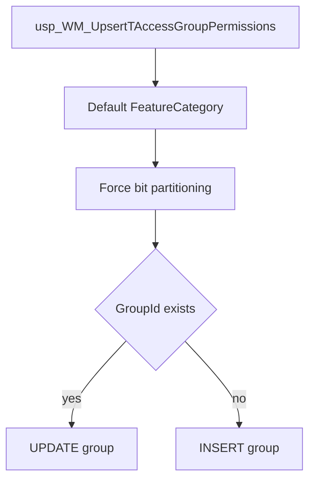

# usp_WM_UpsertTAccessGroupPermissions

## What it does

Inserts or updates one `TWM_TAccessGroupPermissions` row for Configuration → **ACCESS GROUPS**. Defaults `@FeatureCategory` when omitted (`TaskHandoff` for System groups, else `TaskPermissions`). Enforces partitioning: System groups keep only stage bits (task bits forced off); non-`TaskHandoff` categories force stage bits off. Updates when `@GroupId` exists; otherwise inserts an active group.

## Parameters

| Name | Direction | What it is for |
|---|---|---|
| `@GroupId` | in | Null or missing = insert |
| `@GroupName` | in | Group name |
| `@GroupType` | in | System / Real / Virtual |
| `@FeatureCategory` | in | Optional category |
| `@CreateTask` / `@UpdateTask` / `@ModifyPlannedDate` / `@ViewTask` / `@ModifyAssignee` / `@DeleteTask` / `@Baseline` | in | Task permission bits |
| `@AllowedBitArray` / `@ApprovalBitArray` | in | Additional task bits |
| `@AllowStagePromotion` / `@ReceiveStagePromotions` / `@AllowStageRollback` | in | Handoff stage bits |
| `@EmployeeId` | in | Actor for audit |
| `@EmployerID` / `@ProjectID` / `@BusinessUnitID` | in | Scope |
| `@Description` | in | Optional description |

## Call sequence

Calls no other procedures or functions.

## Callers

Application caller: Work Management API save for Configuration → ACCESS GROUPS.

## Nested

Calls no other procedures or functions.

## Steps

1. Default `@FeatureCategory` from `@GroupType` when null.
2. If `@GroupType = 'System'`, zero all task bits.
3. If `@FeatureCategory <> 'TaskHandoff'`, zero the three stage bits.
4. If `@GroupId` exists, `UPDATE` the group; else `INSERT` a new active group with audit fields.

## Tables

| Table | Read or write |
|---|---|
| `dbo.TWM_TAccessGroupPermissions` | read and write |

## Flow

