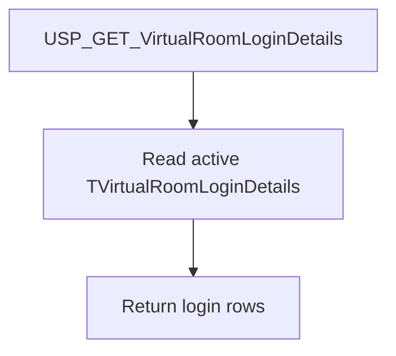

# USP_GET_VirtualRoomLoginDetails

## What it does

Returns active virtual-room login credential rows for an employer, optionally filtered to one employee. My Bookings loads these on mount so GoToMeeting / MS Teams deletes can authenticate before calling `Usp_CRB_DeleteBooking`.

## Parameters

| Name | Direction | What it is for |
|---|---|---|
| `@EmployerID` | in | Employer that owns the login rows |
| `@EmployeeID` | in | Optional employee filter. When null, all employees for the employer are returned |

## Call sequence

Calls no other procedures or functions.

## Callers

No other procedure or function calls this object. App callers: `employeeDAL.getVirtualRoomAuthenticationDetails` → `employeeController.getVirtualRoomAuthenticationDetails` from [My Bookings](/docs/guides/conference-room-booking/my-bookings) (and other CRB screens that load virtual-room logins).

## Nested

Calls no other procedures or functions.

## Steps

1. Script is `HRMS-DATABASE/HRMS-CRBBOOKING/STOREPROCEDURE/USP_GET_VirtualRoomLoginDetails.sql`.
2. Select login columns from `TVirtualRoomLoginDetails` with `NOLOCK`.
3. Filter by `@EmployerID`, optional `@EmployeeID`, and `IsActive = 1`.

## Tables

| Table | Read or write |
|---|---|
| `TVirtualRoomLoginDetails` | read |

## Unresolved calls

None.

## Flow

