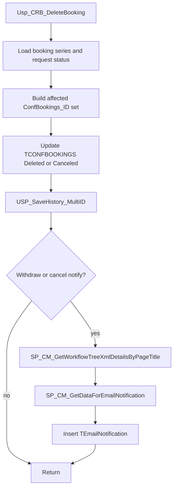

# Usp_CRB_DeleteBooking

## What it does

Marks one conference booking (and optionally related series / pending rows) as deleted or canceled, writes history, retires matching pending request-workflow rows, and may queue a withdraw or cancellation email notification. My Bookings calls it with `deleteFlag` `Y` after optional remote virtual-meeting delete.

## Parameters

| Name | Direction | What it is for |
|---|---|---|
| `@pBookingID` | in | `TCONFBOOKINGS.ConfBookings_ID` to delete or cancel |
| `@deleteFlage` | in | `Y` sets `Status` to `Deleted`; otherwise `Canceled` (parameter name is spelled `deleteFlage` in the script) |
| `@pEmployeeId` | in | Optional actor for `ModifiedBy` / workflow / mail. My Bookings API does not pass this |
| `@pApplyTo` | in | Optional `Series` expands approved future siblings. My Bookings API does not pass this |

## Call sequence

1. Resolve employer, owner, request status, and series from `TCONFBOOKINGS`
2. Build `@Affected` booking ids (single row, pending set, and/or series)
3. Update affected `TCONFBOOKINGS` rows
4. `USP_SaveHistory_MultiID` into `TCONFBOOKINGS_History`
5. Soft-delete matching `TRequestWorkflows` when a withdraw/cancel request type applies
6. `SP_CM_GetWorkflowTreeXmlDetailsByPageTitle` then `SP_CM_GetDataForEmailNotification` and insert `TEmailNotification`

## Callers

No other procedure or function calls this object. App callers: `bookingDAL.DeleteBooking` → `bookingController.DeleteBooking` from [My Bookings](/docs/guides/conference-room-booking/my-bookings) (and other CRB booking UIs that call the same delete route).

## Nested

| Object | When |
|---|---|
| `USP_SaveHistory_MultiID` | After status update, for all affected booking ids |
| `SP_CM_GetWorkflowTreeXmlDetailsByPageTitle` | When employer and withdraw/cancel `@RequestType` are set |
| `SP_CM_GetDataForEmailNotification` | Same notification branch; result inserted into `TEmailNotification` |

## Steps

1. Script is `HRMS-DATABASE/HRMS-CRBBOOKING/STOREPROCEDURE/Usp_CRB_DeleteBooking.sql`.
2. Load employer, owner employee, current `RequestStatus`, and `SeriesId` for `@pBookingID`.
3. Decide withdraw (`Pending` → `Withdrawn`) versus cancel (`Approved` → `Cancelled`) and which sibling ids belong in `@Affected`.
4. If `@deleteFlage` is `Y`, set affected rows to `Status` `Deleted`; else `Canceled`. Clear `PendingRequestId`, set `IsFetched` to 0, stamp `ModifiedBy` / `ModifiedAt`.
5. Copy affected rows to history via `USP_SaveHistory_MultiID`.
6. Soft-delete open `TRequestWorkflows` for booking request / reschedule types when notifying.
7. Resolve workflow id and insert a `TEmailNotification` row from `SP_CM_GetDataForEmailNotification`.

## Tables

| Table | Read or write |
|---|---|
| `TCONFBOOKINGS` | read, write |
| `TCONFBOOKINGS_History` | write (via `USP_SaveHistory_MultiID`) |
| `TRequestWorkflows` | write |
| `TEmailNotification` | write |

## Unresolved calls

None.

## Flow

