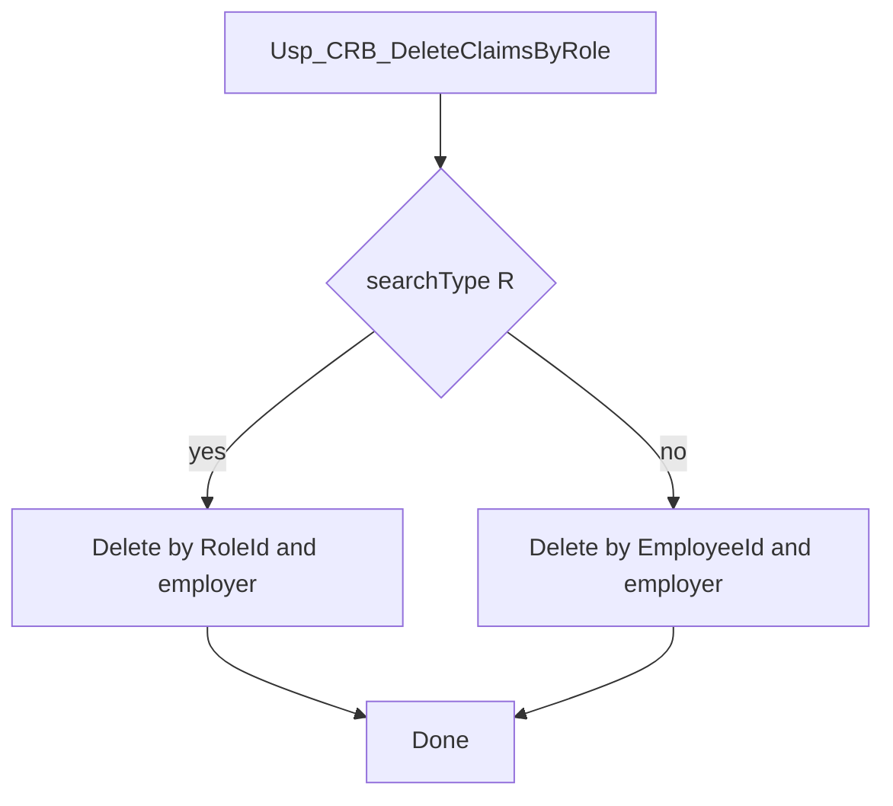

# Usp_CRB_DeleteClaimsByRole

## What it does

Deletes all `TCLAIM_ASSIGNMENT` rows for one role (`searchType` `R`) or one employee (otherwise) under the given employer. Conference Room Booking Permission Setup runs this once inside the save transaction before re-inserting checked claims. It does not write history.

## Parameters

| Name | Direction | What it is for |
|---|---|---|
| `@pRoleID` | in | Role id when `@pSearchType` is `R`. Optional |
| `@pEmployerId` | in | Employer that scopes the delete |
| `@pSearchType` | in | `R` delete by role, otherwise delete by employee |
| `@pEmployeeId` | in | Employee id when search type is not `R`. Optional |

## Call sequence

Calls no other procedures or functions.

## Callers

No other procedure or function calls this object. App callers: `employeeDAL.DeleteClaimsBySearchType` from `employeeBLL.InsertClaimsBySearchType` on [Conference Room Booking Permission Setup](/docs/guides/admin-configuration/conference-room-booking-permission-setup).

## Nested

Calls no other procedures or functions.

## Steps

1. Script is `HRMS-DATABASE/HRMS-CRBBOOKING/STOREPROCEDURE/Usp_CRB_DeleteClaimsByRole.sql`.
2. Delete from `TCLAIM_ASSIGNMENT` where `Employerid = @pEmployerId` and either `RoleId = @pRoleID` or `EmployeeId = @pEmployeeId` based on `@pSearchType`.

## Tables

| Table | Read or write |
|---|---|
| `TCLAIM_ASSIGNMENT` | write (delete) |

## Unresolved calls

None.

## Flow

