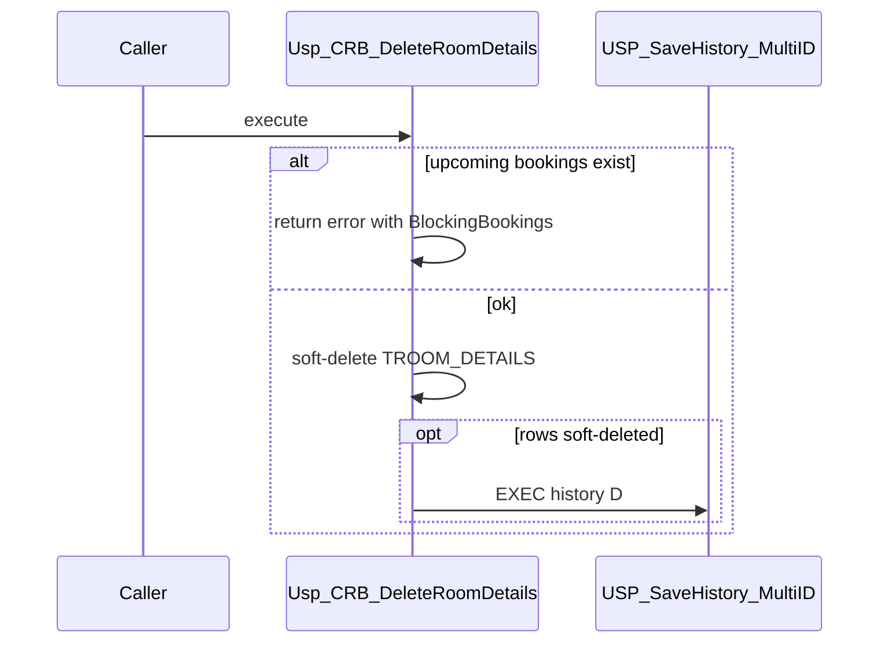
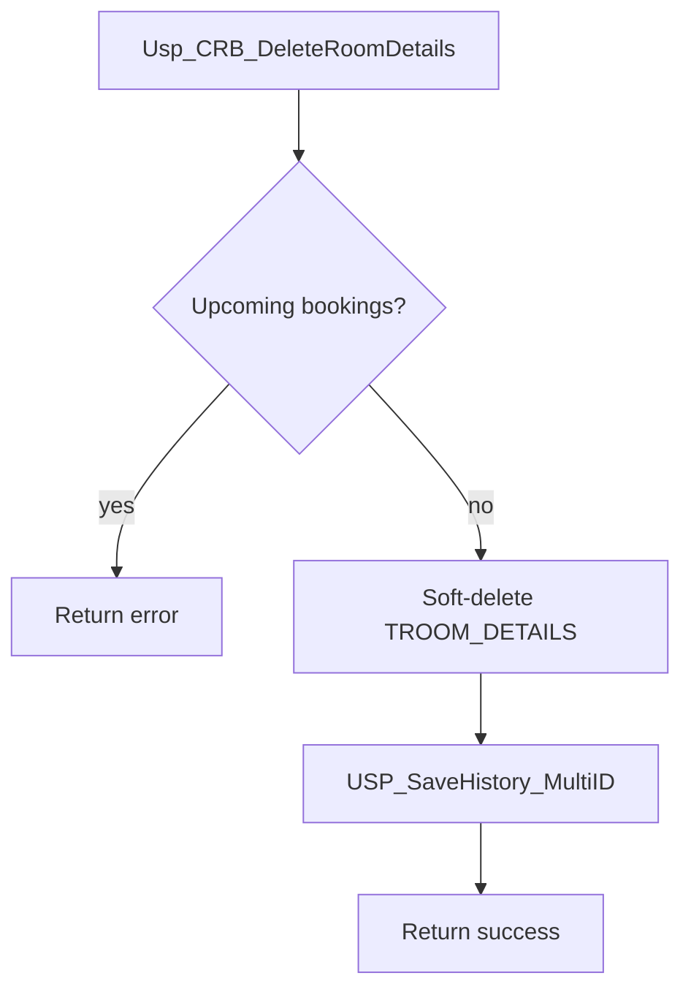

# Usp_CRB_DeleteRoomDetails

## What it does

Soft-deletes all active `TROOM_DETAILS` amenity rows for one employer/floor/room and writes history via `USP_SaveHistory_MultiID`. Blocks the delete when the room still has upcoming (non-canceled/deleted) bookings in `TCONFBOOKINGS`.

## Parameters

| Name | Direction | What it is for |
|---|---|---|
| `@pEmployerid` | in | Employer scope; history created-by |
| `@pFloorID` | in | Floor lookup id |
| `@pRoomID` | in | Room lookup id |

## Call sequence

## Callers

No other procedure or function in `HRMS-CRBBOOKING` calls this object. Application caller: CRB WebAPI `DeleteMasterData` via `masterDataDAL.DeleteMasterData` (note V1 DAL parameter drift — see Master Data guide Known gaps).

| Caller | Page |
|---|---|
| (application only) | No page yet |

## Nested

| Object | Kind | When | Page |
|---|---|---|---|
| `USP_SaveHistory_MultiID` | procedure (synonym to core) | After soft-deleting room-detail rows | [USP_SaveHistory_MultiID](/docs/database/hrms/USP_SaveHistory_MultiID) |

## Steps

1. Script is `HRMS-DATABASE/HRMS-CRBBOOKING/STOREPROCEDURE/Usp_CRB_DeleteRoomDetails.sql`.
2. Count non-canceled/deleted bookings for the room with `BookingEndDate >=` today (UTC date); if any, return failure.
3. Soft-delete active `TROOM_DETAILS` rows for employer/floor/room (`IsDeleted = 1`).
4. When ids exist, `EXEC dbo.USP_SaveHistory_MultiID` for `TROOM_DETAILS` → `TROOM_DETAILS_History` with `ActionType` `D`.
5. Return success and amenity row count deleted.

## Tables

| Table | Read or write |
|---|---|
| `dbo.TCONFBOOKINGS` | read |
| `dbo.TROOM_DETAILS` | write |
| `dbo.TROOM_DETAILS_History` | write via nested `USP_SaveHistory_MultiID` |

## Unresolved calls

None.

## Flow

