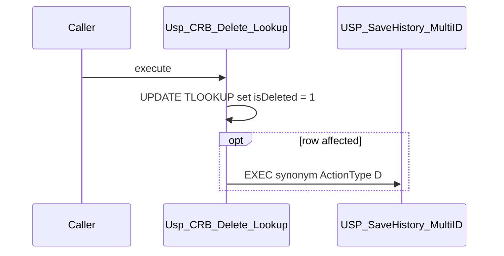
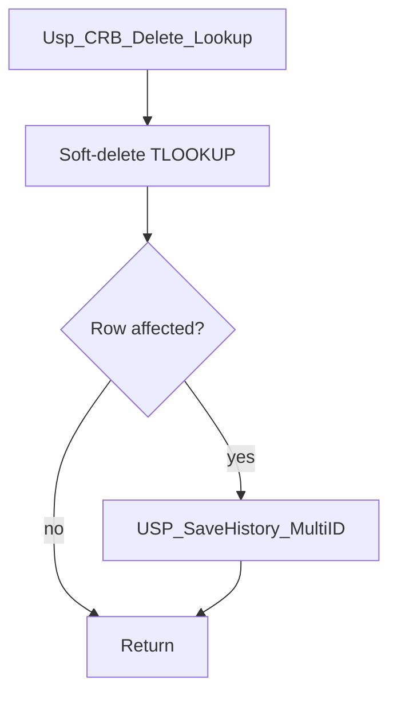

# Usp_CRB_Delete_Lookup

## What it does

Soft-deletes one Conference Room Booking `TLOOKUP` row by setting `isDeleted = 1` for the given lookup id and employer. When a row was affected, it calls `USP_SaveHistory_MultiID` (CRB synonym to core) with action type `D` to snapshot into `TLOOKUP_History`. Errors are re-raised from a CATCH block.

## Parameters

| Name | Direction | What it is for |
|---|---|---|
| `@pLookupID` | in | Lookup id to soft-delete |
| `@pEmployerid` | in | Employer scope; also passed as history created-by |

## Call sequence

## Callers

No other procedure or function in `HRMS-CRBBOOKING` calls this object. Application caller: CRB WebAPI `DeleteLookupItem` via `commonDAL.DeleteLookupItem`.

| Caller | Page |
|---|---|
| (application only) | No page yet |

## Nested

| Object | Kind | When | Page |
|---|---|---|---|
| `USP_SaveHistory_MultiID` | procedure (synonym to core) | After a successful soft-delete | [USP_SaveHistory_MultiID](/docs/database/hrms/USP_SaveHistory_MultiID) |

## Steps

1. Script is `HRMS-DATABASE/HRMS-CRBBOOKING/STOREPROCEDURE/Usp_CRB_Delete_Lookup.sql`.
2. Soft-delete `TLOOKUP` where `Lookup_Id` and `Employerid` match; capture id via OUTPUT.
3. If a row was affected, set `@ActionType = 'D'` and `EXEC dbo.USP_SaveHistory_MultiID` for `TLOOKUP` → `TLOOKUP_History`.
4. On error, capture severity/state and `RAISERROR`.

## Tables

| Table | Read or write |
|---|---|
| `dbo.TLOOKUP` | write (soft-delete) |
| `dbo.TLOOKUP_History` | write via nested `USP_SaveHistory_MultiID` |

## Unresolved calls

None.

## Flow

