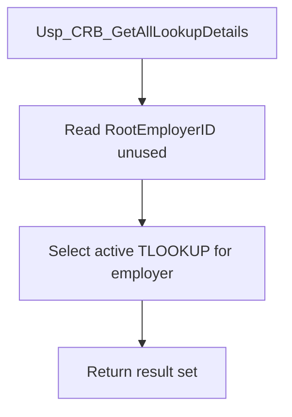

# Usp_CRB_GetAllLookupDetails

## What it does

Returns non-deleted Conference Room Booking lookup rows for one employer from `TLOOKUP`, including parent text via a correlated subquery on the same employer. Declares `@RootEmployerID` from `temployerdetails` but does not use it in the select. Calls no other procedure or function.

## Parameters

| Name | Direction | What it is for |
|---|---|---|
| `@pEmployerId` | in | Employer scope for the lookup list |

## Call sequence

Calls no other procedures or functions.

## Callers

No other procedure or function in `HRMS-CRBBOOKING` calls this object. Application caller: CRB WebAPI `GetAllLookupDetails` via `commonDAL.GetAllLookupDetails`.

| Caller | Page |
|---|---|
| (application only) | No page yet |

## Nested

Calls no other procedures or functions.

## Steps

1. Script is `HRMS-DATABASE/HRMS-CRBBOOKING/STOREPROCEDURE/Usp_CRB_GetAllLookupDetails.sql`.
2. Set `@RootEmployerID` from `temployerdetails` for `@pEmployerId` (unused later).
3. Select `LookupId`, `LookupText`, `LookupParentId`, `SubParentId` (isnull to 0), and `LookupParentText` from parent row with the same employer.
4. Filter to `isDeleted` null or 0 and `Employerid = @pEmployerId`.

## Tables

| Table | Read or write |
|---|---|
| `dbo.TLOOKUP` | read |
| `dbo.temployerdetails` | read (unused `@RootEmployerID`) |

## Unresolved calls

None.

## Flow

