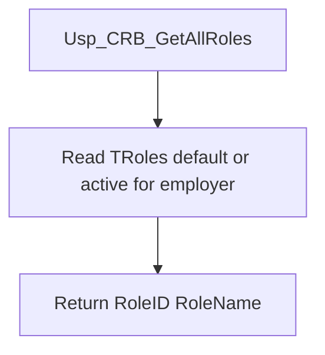

# Usp_CRB_GetAllRoles

## What it does

Returns `RoleID` and `RoleName` from `TRoles` for default roles (`IsDefault = 1`) or active roles (`IsActive = 'Y'`) for the requested employer. Conference Room Booking Permission Setup uses the list for the role dropdown.

## Parameters

| Name | Direction | What it is for |
|---|---|---|
| `@pEmployerId` | in | Employer whose active roles are listed, plus default roles |

## Call sequence

Calls no other procedures or functions.

## Callers

No other procedure or function calls this object. App callers: `employeeDAL.GetAllRoles` → `employeeController.GetAllRoles` from [Conference Room Booking Permission Setup](/docs/guides/admin-configuration/conference-room-booking-permission-setup).

## Nested

Calls no other procedures or functions.

## Steps

1. Script is `HRMS-DATABASE/HRMS-CRBBOOKING/STOREPROCEDURE/USp_CRB_GetAllRoles.sql`.
2. Select `RoleID`, `RoleName` from `[dbo].[TRoles]` where `IsDefault = 1` or (`IsActive = 'Y'` and `Employerid = @pEmployerId`).

## Tables

| Table | Read or write |
|---|---|
| `TRoles` | read (CRB synonym to HRMS `TRoles`) |

## Unresolved calls

None.

## Flow

