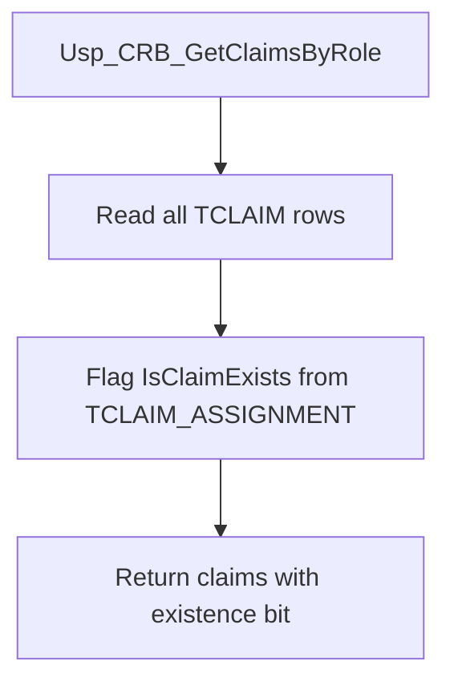

# Usp_CRB_GetClaimsByRole

## What it does

Returns every row from `TCLAIM` with an `IsClaimExists` bit for the selected role (`searchType` `R`) or employee (`searchType` `E`) under the given employer. Conference Room Booking Permission Setup uses the result for claim checkboxes; the UI then filters by `ModuleID`.

## Parameters

| Name | Direction | What it is for |
|---|---|---|
| `@pRoleId` | in | Role id when `@pSearchType` is `R`. Optional |
| `@pEmployerId` | in | Employer that scopes `TCLAIM_ASSIGNMENT` |
| `@pSearchType` | in | `R` match by role, otherwise match by employee |
| `@pEmployeeId` | in | Employee id when search type is not `R`. Optional |

## Call sequence

Calls no other procedures or functions.

## Callers

No other procedure or function calls this object. App callers: `employeeDAL.GetClaimsBySearchType` → `employeeController.GetClaimsBySearchType` from [Conference Room Booking Permission Setup](/docs/guides/admin-configuration/conference-room-booking-permission-setup).

## Nested

Calls no other procedures or functions.

## Steps

1. Script is `HRMS-DATABASE/HRMS-CRBBOOKING/STOREPROCEDURE/Usp_CRB_GetClaimsByRole.sql`.
2. Select `ClaimID`, `ClaimText`, `ClaimText_Short` as `ClaimShortText`, and `ModuleID` from `TCLAIM`.
3. For each claim, set `IsClaimExists` to 1 when a matching `TCLAIM_ASSIGNMENT` row exists for the role or employee and employer; otherwise 0.

## Tables

| Table | Read or write |
|---|---|
| `TCLAIM` | read |
| `TCLAIM_ASSIGNMENT` | read |

## Unresolved calls

None.

## Flow

