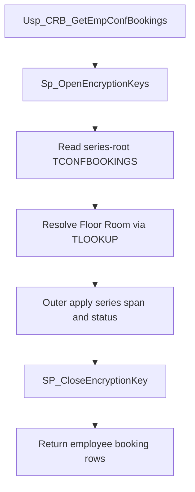

# Usp_CRB_GetEmpConfBookings

## What it does

Returns the signed-in employee’s conference booking series roots for one employer. Each row is a series head (`ConfBookings_ID = SeriesId`) with series date span, occurrence count, floor/room lookup text, virtual-meeting fields, and a preferred request-status snapshot from sibling occurrences. My Bookings uses the result for the employee grid.

## Parameters

| Name | Direction | What it is for |
|---|---|---|
| `@pEmployerId` | in | Employer that owns the bookings |
| `@pEmployeeId` | in | Booking owner (employee) to list |

## Call sequence

1. `Sp_OpenEncryptionKeys`
2. Select from `TCONFBOOKINGS` with `TEmployerDetails` / `TLOOKUP` / series outer applies and `Fn_GetEmployeeName`
3. `SP_CloseEncryptionKey`

## Callers

No other procedure or function calls this object. App callers: `bookingDAL.GetMyBookingList` → `bookingBLL.GetMyBookingList` → `bookingController.GetMyBookingList` from [My Bookings](/docs/guides/conference-room-booking/my-bookings).

## Nested

| Object | When |
|---|---|
| `Sp_OpenEncryptionKeys` | Start of body |
| `Fn_GetEmployeeName` | Employee display name column |
| `SP_CloseEncryptionKey` | End of body |

## Steps

1. Script is `HRMS-DATABASE/HRMS-CRBBOOKING/STOREPROCEDURE/Usp_CRB_GetEmpConfBookings.sql`.
2. Open encryption keys, then set `READ UNCOMMITTED`.
3. Select series-root rows from `TCONFBOOKINGS` for `@pEmployerId` / `@pEmployeeId` with status in `New`, `Processed`, `Updated`, `Canceled`.
4. Resolve floor and room names from `TLOOKUP` (parents `100` / `200`) scoped by employer.
5. Outer-apply series min/max dates, occurrence count, and weekday aggregation from matching `SeriesId` rows.
6. Outer-apply a preferred `RequestStatus` / `Status` / `CustomStatusInformation` from series siblings.
7. Order by `CreatedDate` descending, then close encryption keys.

## Tables

| Table | Read or write |
|---|---|
| `TCONFBOOKINGS` | read |
| `TEmployerDetails` | read |
| `TLOOKUP` | read |

## Unresolved calls

None.

## Flow

