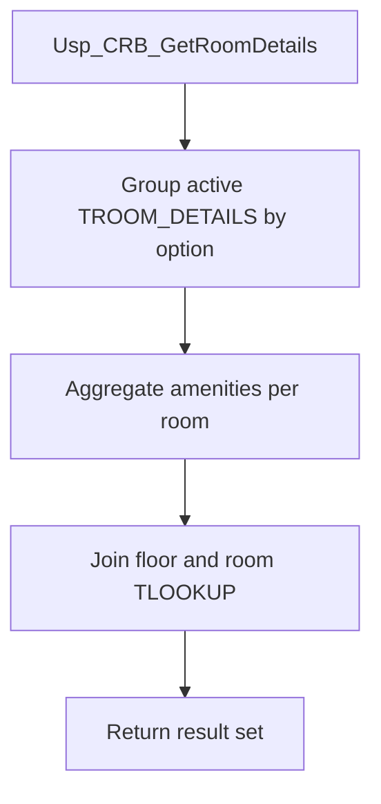

# Usp_CRB_GetRoomDetails

## What it does

Returns one aggregated row per active employer/floor/room from `TROOM_DETAILS`, with de-duplicated amenity option ids and names, seating capacity (max quantity), floor/room display text from `TLOOKUP`, and room `RequiresApproval` / `UpdatedAt`. Calls no other procedure or function.

## Parameters

| Name | Direction | What it is for |
|---|---|---|
| `@pEmployerid` | in | Employer scope for room-detail rows |

## Call sequence

Calls no other procedures or functions.

## Callers

No other procedure or function in `HRMS-CRBBOOKING` calls this object. Application caller: CRB WebAPI `GetAllMasterDataList` via `masterDataDAL.GetAllMasterDataList` (Master Data screen).

| Caller | Page |
|---|---|
| (application only) | No page yet |

## Nested

Calls no other procedures or functions.

## Steps

1. Script is `HRMS-DATABASE/HRMS-CRBBOOKING/STOREPROCEDURE/Usp_CRB_GetRoomDetails.sql`.
2. CTE `RoomOption` groups non-deleted `TROOM_DETAILS` by employer/floor/room/option (max quantity, min id).
3. CTE `RoomAgg` aggregates options per room with `STRING_AGG` of option ids and amenity names from `TLOOKUP`.
4. Outer select joins floor (`Lookup_Parent_ID = 100`) and room (`Lookup_Parent_ID = 200`) lookup text, plus `RequiresApproval` and `UpdatedAt` from the room lookup, ordered by floor then room name.

## Tables

| Table | Read or write |
|---|---|
| `dbo.TROOM_DETAILS` | read |
| `dbo.TLOOKUP` | read |

## Unresolved calls

None.

## Flow

