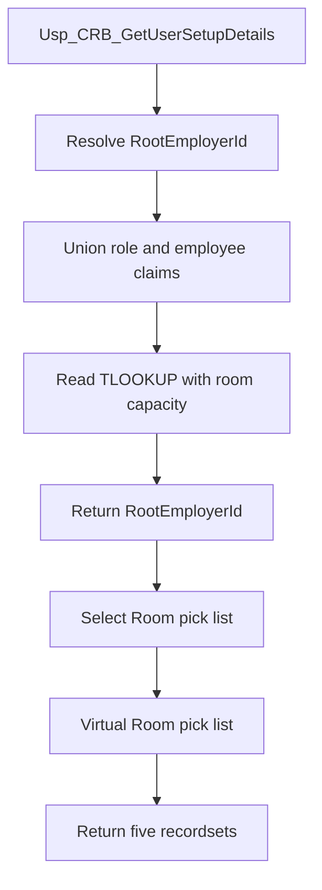

# Usp_CRB_GetUserSetupDetails

## What it does

Returns five result sets that bootstrap a Conference Room Booking React host for one role, employer, and employee: (1) claim ids/text from role-scoped and employee-scoped `TCLAIM_ASSIGNMENT` rows, (2) non-deleted employer `TLOOKUP` rows with optional seating capacity from `TROOM_DETAILS` when the lookup parent is `200`, (3) `RootEmployerId` from `TEmployerDetails`, (4) room pick-list children under parent text **Select Room**, (5) virtual-room pick-list children under parent text **Virtual Room**. Calls no other procedure or function.

## Parameters

| Name | Direction | What it is for |
|---|---|---|
| `@pRoleId` | in | Role whose claim assignments are unioned into the first result set |
| `@pEmployerid` | in | Employer scope for claims, lookups, and pick lists; also used to resolve root employer |
| `@pEmployeeId` | in | Employee whose claim assignments are unioned into the first result set |

## Call sequence

Calls no other procedures or functions.

## Callers

No other procedure or function in `HRMS-CRBBOOKING` calls this object. Application callers: CRB WebAPI `employeeDAL.GetUserSetupDetails` → `employeeController.GetUserSetupDetails` from [Notifications](/docs/guides/conference-room-booking/notifications) (`SetupUser`) and [Master Data](/docs/guides/conference-room-booking/master-data) (and other CRB hosts that share the same bootstrap).

| Caller | Page |
|---|---|
| (application only) | [Notifications](/docs/guides/conference-room-booking/notifications), [Master Data](/docs/guides/conference-room-booking/master-data) |

## Nested

Calls no other procedures or functions.

## Steps

1. Script is `HRMS-DATABASE/HRMS-CRBBOOKING/STOREPROCEDURE/Usp_CRB_GetUserSetupDetails.sql`.
2. Resolve `@RootEmployerID` from synonym `TEmployerDetails` / `temployerdetails` for `@pEmployerid`.
3. Select claims for the role and employer from `TCLAIM_ASSIGNMENT` joined to `TCLAIM`, union claims for the employee and employer.
4. Select employer `TLOOKUP` rows that are not deleted, outer-applying latest non-deleted `TROOM_DETAILS.Quantity` when `Lookup_Parent_ID = 200`.
5. Select `@RootEmployerID` as `RootEmployerId`.
6. Select lookup children under parents whose text is **Select Room**, then under parents whose text is **Virtual Room**, both scoped to `@pEmployerid`.

## Tables

| Table | Read or write |
|---|---|
| `dbo.TCLAIM` | read |
| `dbo.TCLAIM_ASSIGNMENT` | read |
| `dbo.TLOOKUP` | read |
| `dbo.TROOM_DETAILS` | read |
| `dbo.TEmployerDetails` | read (CRB synonym to HRMS `TEmployerDetails`) |

## Unresolved calls

None.

## Flow

