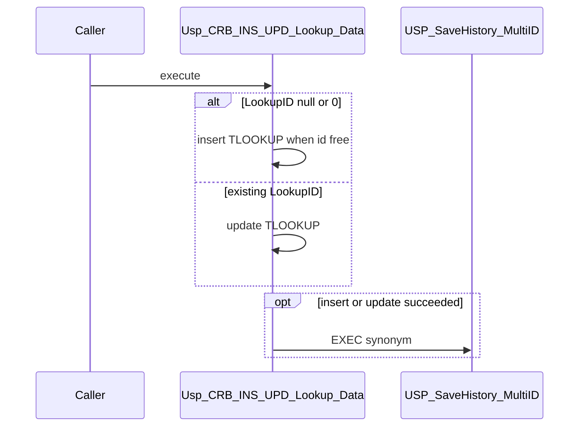
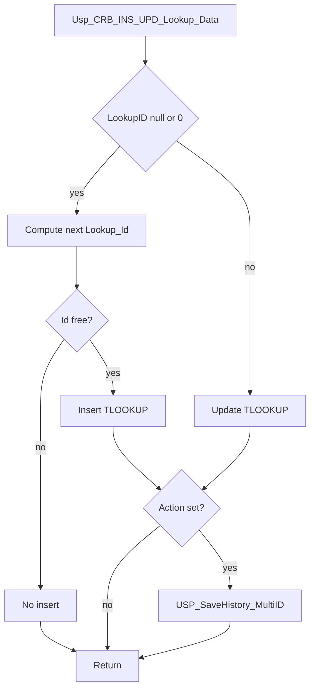

# Usp_CRB_INS_UPD_Lookup_Data

## What it does

Inserts or updates a Conference Room Booking `TLOOKUP` row for one employer. On insert it allocates the next `Lookup_Id` under the parent (or `parent + 1` when none exist) and skips insert if that id already exists. On update it changes `Lookup_Text` and `SUB_PARENT_ID`. When a row was inserted or updated, it calls `USP_SaveHistory_MultiID` (CRB synonym to core) to snapshot into `TLOOKUP_History`.

## Parameters

| Name | Direction | What it is for |
|---|---|---|
| `@pLookupID` | in | Existing lookup id; null/0 means insert |
| `@pLookupText` | in | Display text (NVARCHAR(50) in the procedure signature) |
| `@pLookupParentId` | in | Parent reference type id |
| `@pSubParentId` | in | Sub-parent (for rooms, the floor lookup id) |
| `@pEmployerid` | in | Employer scope; also passed as history created-by |

## Call sequence

## Callers

No other procedure or function in `HRMS-CRBBOOKING` calls this object. Application caller: CRB WebAPI `SaveLookupItem` via `commonDAL.SaveLookupItem`.

| Caller | Page |
|---|---|
| (application only) | No page yet |

## Nested

| Object | Kind | When | Page |
|---|---|---|---|
| `USP_SaveHistory_MultiID` | procedure (synonym to core) | After a successful insert or update | [USP_SaveHistory_MultiID](/docs/database/hrms/USP_SaveHistory_MultiID) |

## Steps

1. Script is `HRMS-DATABASE/HRMS-CRBBOOKING/STOREPROCEDURE/Usp_CRB_INS_UPD_Lookup_Data.sql`.
2. If `@pLookupID` is null/0, compute next `Lookup_Id` for the parent and employer; if that id is free, insert into `TLOOKUP` with `RootEmployerid = @pEmployerid`, `IsDeleted = 0`.
3. Else update `Lookup_Text` and `SUB_PARENT_ID` for the employer.
4. Capture inserted/updated ids via table variables and set `@ActionType` to `I` or `U`.
5. When a final lookup id and action type exist, `EXEC dbo.USP_SaveHistory_MultiID` for `TLOOKUP` → `TLOOKUP_History`.

## Tables

| Table | Read or write |
|---|---|
| `dbo.TLOOKUP` | read and write |
| `dbo.TLOOKUP_History` | write via nested `USP_SaveHistory_MultiID` |

## Unresolved calls

None.

## Flow

